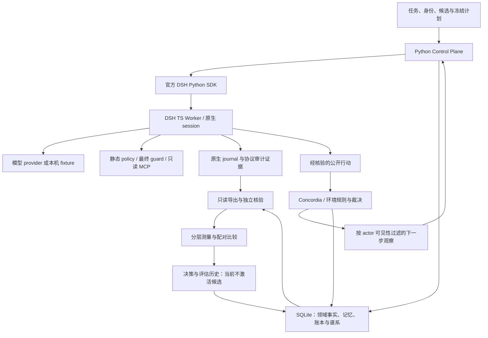

# Actio-RSI

**面向持久身份、社会交互与受控演化 Agent 的实验基础设施。**

Actio-RSI 将 Agent 的身份与记忆、模型运行、环境裁决、事实记录、独立评估和候选版本谱系连接起来。项目希望让研究者能够回答：Agent 在什么条件下做出了什么行动？修改了哪个组件？变化是否有完整证据，是否足以允许进入下一阶段？

当前已经实现 Windows 单机上的 Python 控制面、官方 DSH 运行时接入、Concordia 双人任务、持久化账本与离线核验，并完成一个人工候选的真实配对试验。长期目标中的完整心智模型、开放式自主演化、训练和生产版本激活仍待建设。

**当前交付：Phase 1C2C3。** 已提供离线任务诊断、C2C2回顾性分析和8组/16世界/32展示的合成诊断包，完成416个合法行动组合的规则交叉核验。本轮真实调用0；C2C2仍为24 episodes、48 sends、12 pairs、逐卡delta=0，C1仍为`insufficient_evidence`、activation=false。合成控制的判别力不等于真实模型或候选效果。

[当前结果](docs/validation/phase1c2c3/RESULTS.md) · [当前 Gate](docs/validation/phase1c2c3/GATES.md) · [离线CLI](docs/validation/phase1c2c3/CLI.md) · [完整里程碑](MILESTONES.md) · [原始架构规划](docs/planning/README.md)

## 阅读导航

- [项目背景与目标](#项目背景与目标)
- [架构与组织逻辑](#架构与组织逻辑)
- [输入、执行与输出](#输入执行与输出)
- [已经完成什么](#已经完成什么)
- [使用方法](#使用方法)
- [仓库与证据导航](#仓库与证据导航)
- [后续 TODO](#后续-todo)
- [开发、复用与文档维护](#开发复用与文档维护)

## 项目背景与目标

### 为什么需要这层基础设施

一次模型调用可以返回答案，但持续运行的 Agent 还需要处理身份延续、跨任务记忆、私有信息可见性、工具效果、世界状态和失败恢复。加入“演化”之后，还需要说明候选改变了什么、由谁评估、用什么数据评估，以及拒绝和失败是否与成功一样被保存。

Actio-RSI 以这些可追踪的边界为建设重点。RSI 在这里是受控迭代与演化的研究方向；当前最小实现只允许一个人工定义的提示词清单候选进入隔离评估，尚未建立自动递归改进循环。

项目面向两条共享基础能力的路径：

| 路径 | 目标用途 | 当前落地 |
|---|---|---|
| Human / Society Simulation | 在环境规则和信息可见性约束下研究交互、协商与社会行为 | 真实 Concordia Sequential，排期和多物品议价两个合成任务 family |
| Socially-Minded Assistant | 持续身份、跨任务记忆、工具使用与长期适应 | 确定性 fixture 助手、只读 MCP、显式授权的 assistant → social memory 共享 |

助手和社会场景共用身份、运行记录、事实、记忆与核验机制；各环境负责自己的合法行动和结果裁决。当前社会任务使用固定规则与独立 oracle，尚未验证完整社会仿真保真度。

### 自有核心与开源复用

建设原则是 **复用已有运行实现，自有领域抽象与证据合同**。重点自有能力为：

1. 身份、Persona、记忆及未来心智状态的边界。
2. 控制面、原生运行时和环境之间的状态协调。
3. 事实、来源、执行回执及未来检查点的一致记录。
4. 独立评估、准入决策与不可变版本谱系。
5. 有限干预、配对实验与归因证据。

这五项是长期建设主线，当前完成程度见下方能力表。详细需求和取舍见 [项目定位](docs/planning/00_project_positioning.md)、[复用矩阵](docs/planning/02_reuse_decision_matrix.md) 与 [架构决策](docs/planning/13_architecture_decisions.md)。

## 架构与组织逻辑

当前部署形态是 **一个 Python 应用 + 受管 DSH Worker + SQLite / 文件证据**。规划中的多个逻辑 plane 表示责任划分，尚未拆成一组分布式服务。



该图概括共享边界。只读 MCP 由助手 fixture 路径验证，C2C2 的 solver 配对按自身冻结任务合同运行；并非每个 episode 都会调用所有组件。

### 谁负责什么状态

| 层 | 职责与主要实现 | 所有权边界 |
|---|---|---|
| 控制与身份 | `store.py`、`database.py`、`scenarios.py`：身份/spec、run、lease、一次执行资格 | Python 持有领域状态；冻结后的输入和旧身份不会随新源码静默改写 |
| 运行时适配 | `runtime.py`、`host.py`、`supervisor.py`：SDK、隔离 home、Worker 生命周期、具名 Job | DSH 持有原生 session、loop 与 journal；Python 不作为第二个原生 journal 写者 |
| 模型与工具边界 | `transport.py`、`budget.py`、`plugins/`：最终发送/工具 guard、attempt、usage、期限 | 每次发送有持久记录；unknown 不能被当成未发生或自动重试资格 |
| 环境与任务 | `scenarios.py`、`suite_tasks.py`、`suite_oracle.py`：可见观察、行动空间、世界裁决 | Agent 提交行动，环境决定合法性和效果；评估器可用的全局状态不直接给 actor |
| 事实与记忆 | `facts.py`、`memory.py`、`evidence.py`：来源关联、namespace、revision、导出 | 私有 memory 按身份与共享策略访问；JSON 报告是投影，不是第二权威数据库 |
| 候选与评估 | `candidate_*.py`、`evaluation_*.py`：静态提案、配对、独立指标、evaluation history | 候选只能改变允许的字段；不能修改数据、评估规则、权限或账本 |

模型输出、原生执行结束、环境任务成功、证据完整和能力准入分别判断。可信但非法的行动可以被完整记录为行为失败；合法拒绝可以是规则遵守；缺失响应和不明发送则属于技术证据缺口。

### 当前复用的资产

| 上游资产 | 当前用法 | 使用边界 |
|---|---|---|
| [DeepSeek Harness](https://github.com/deepseek-ai/deepseek-harness) | 官方 Python SDK / TS runtime `0.1.5rc1`，session、plugin、Chat Completions adapter 与 MCP 能力 | 固定发行物和 hash；二进制到参考源码的构建映射仍未证明 |
| [Concordia](https://github.com/google-deepmind/concordia) | 固定 commit 的 Engine / Entity / Sequential 及 ActionSpec 相关能力 | 安装必要源码导入闭包；任务和独立 oracle 由 Actio 定义 |
| [Raven](https://github.com/EverMind-AI/Raven) | 配对诊断和档案选择语义的窄复用依据 | 不采用整体 root fork，不直接照搬其晋升或持久化规则 |
| SOTOPIA | 最小 parser / schema 抽取与受控评估接口验证 | 完整上游 evaluator 兼容性失败记录保留，尚未作为当前 live judge |

固定来源、许可与二开拆分见 [资产拆解计划](docs/planning/17_reuse_extraction_plan.md)、[SOTOPIA 复用记录](docs/validation/phase1c0/05_sotopia_reuse.md) 和 [C2C1 合同](docs/validation/phase1c2c1/CONTRACT.md)。Strands 是历史备选；Graphiti、额外 simulator、viewer 与外部训练服务属于后续方向，尚未部署为当前依赖。

## 输入、执行与输出

### 领域对象如何关联

| 对象 | 含义 | 与其他对象的关系 |
|---|---|---|
| Agent / AgentSpec | 持久身份与封存配置，包括 Persona、源码/运行时 pins 和 memory 共享策略 | 一个身份可参与多个 run；配置变更需要明确的新身份或版本合同 |
| Task card | 一个合成任务实例：公开规则、各 actor 自身信息、合法行动与 oracle 输入 | live合同仍为原12卡；另有独立离线32展示诊断集，均分scheduling / bargaining两类 |
| Episode / seat | 一次任务执行；seat 是其中一个 actor 的执行位置 | 当前每 episode 顺序执行 A → B，技术或任务合同可规定跳过 B |
| Candidate / scaffold | 一个带 parent 和内容 hash 的有限修改提案 | B0 是空清单参照；C1 只给 A 增加三条通用行动前检查 |
| Campaign / arm pair | 有序实验计划及同一卡的 baseline/candidate 对照 | C2C2 为 12 卡 × 2 arms × 1 route × 1 repeat |
| Evaluation / decision | 某个候选在特定冻结计划上的评估及结论 | 同一候选可以关联旧 local 和新 live 评估，旧决策不覆盖 |

这里的 48 个 seat、24 个 episode、12 个配对是不同层级的工程分母，不能合并成独立研究样本数。

### 一次 A → B 执行的数据流

1. **冻结输入。** 绑定 AgentSpec、task、初始 memory、candidate、模型配置、运行时、期限、评估规则及有序计划。
2. **构造 A 的可见输入。** 只包含公开信息、自身约束、授权记忆和本 arm 的 scaffold。对方私有状态、oracle 答案和 arm 标签不进入 actor 提示。
3. **持久登记并调用。** 控制面获取一次执行资格，经官方 SDK / DSH 发出请求；记录 attempt、原始协议证据、usage 与终态。
4. **核验行动并更新环境。** 比较 raw → adapter → native 行动文本，环境验证 ActionSpec 和任务规则，再产生领域结果。`reasoning_content` 只参与协议审计，只有 `content` 进入行动、memory 和下一个 actor。
5. **构造 B 的输入。** B 看到本 arm 实际发生的 A 公开行动和 B 自身信息。A 在两臂输出不同时，B 的公开历史允许相应变化，其余权限与自身输入保持边界。
6. **封存和独立评估。** 导出事实与账本，逐项计算格式、规则遵守、联合结果、toy utility 等，追加 evaluation / decision，保留失败、缺失和未运行单位。

可信的格式错误不会被修成“正确答案”后重跑。技术异常按冻结停止规则处理；被跳过和未运行的单位仍留在计划分母中。

### 会产生什么输出

| 输出 | 内容 | 读者与用途 |
|---|---|---|
| SQLite Store / Ledger | 身份、run、领域事实、memory、attempt、usage、候选与评估事件 | 控制面与只读审计；权威持久状态 |
| 原生 journal / 协议材料 | 实际请求、响应通道、Worker 回执及清理证据 | 核验执行是否发生、输入是否绑定、文本是否一致 |
| `report.json` / 分层计数 | 每 seat、episode、arm pair 的观测、指标、delta、null 与原因 | 研究者查看完整计划和缺失情况 |
| `lineage.json` / `decision.json` | proposal → parent → evaluation → evidence → decision | 追踪同一候选多次评估，保留 reject / insufficient / infrastructure failure |
| `delivery.json` / manifest | 可核验的完整导出或其受控位置与 hash、固定 reader | 重算、交付与版本关联 |

**公开报告与完整原始证据分层保存。** C2C2 的 Git 仓库包含公开投影、结果和来源引用；完整 delivery 含原始协议材料，保存在受控本地归档。仅 clone 本仓库可以审阅公开结果，无法仅凭公开投影独立重算全部 raw/adapter/native 核验。具体边界见 [受控交付引用](docs/validation/phase1c2c2/controlled-delivery.json)。

## 已经完成什么

### 当前能力状态

以下以 [C2C2 真实执行](docs/validation/phase1c2c2/RESULTS.md) 和 [C2C3 离线诊断](docs/validation/phase1c2c3/RESULTS.md) 为依据。通过表示在对应合同、环境和证据范围内通过。

| 能力 | 当前状态 | 仍需区分的边界 |
|---|---|---|
| 持久身份、SQLite 事实、memory revision、单 run 导出 | 已实现并验收 | 尚无完整信念、情绪、关系等 MentalState 系统 |
| 官方 DSH / MCP / 进程隔离与有界清理 | 固定 Windows x64 栈通过 | native resume/fork/catchup、semantic cancel、完整 world restore 不支持 |
| 助手与社会场景共享基础设施 | fixture 双场景通过；社会任务已接真实 solver | 通用生产助手和大规模社会仿真尚未交付 |
| 真实模型传输 | C2B1 多路由 smoke；C2C2 单 `gpt-5.6` TokenKey 路由完成 | 仅证明实际观察到的协议路径，上游权重身份未验证 |
| 输入与双通道审计 | raw / adapter / native、隐藏信息边界与实际 A → B 历史已验收 | 协议之外的真实性或模型思维过程不由这些检查证明 |
| 任务与独立测量 | 两个 family、12 张合成开发卡、分层分母和独立 oracle | 真人标签 0；独立研究单位 0；尚无外部效度结论 |
| 可见信息与任务诊断 | 纯可见参考策略、条件最优集合、8/16/32合成集、可移植离线核验 | 隐藏世界不相容与控制敏感性已验；真实solver判别力NOT_RUN，条件得分不是期望收益 |
| 候选评估与谱系 | 单 A scaffold 候选、schema 4、跨评估历史与复制迁移已交付 | C1 为 `insufficient_evidence`；B0 是参照；无自动激活 |
| 账务与发送记录 | 发送、usage、unknown、有限计划和一次资格持续记录 | 费用币种/单位、可信报价与供应商账单未核实 |

C2C2 实际发送 48 次，unknown=0、not_run=0；全部 12 个配对的逐卡指标 delta=0。历史与本轮累计真实生成尝试为 **139**，目录 GET 另计 1，开发/验收的本机发送另列。它们是操作计数，不能当成模型质量排名或独立统计样本。

C2C2 的本机验收还覆盖了格式错误、跳过、unknown 停止和 controller/verifier 故障；这些合成案例与真实试验结果分开。验证版本、失败记录和实际执行范围见 [开发记录](docs/validation/phase1c2c2/DEVELOPMENT.md) 与 [manifest](docs/validation/phase1c2c2/evidence_manifest.json)。

### 主要里程碑

| 阶段 | 建成的最小闭环 | 交付入口 |
|---|---|---|
| Phase 0 / 1 规划 | 开源资产审计、领域模型、ADR、拆解与 MVP 路线 | [规划总览](docs/planning/README.md) |
| 1A | 官方 SDK / TS runtime、MCP、隔离、SQLite 与真实 Concordia 的资产准入 | [验证总览](docs/validation/phase1a/README.md) |
| 1B / 1B.1 | 持久身份与 fixture 双场景；迁移、快照导出、离线 verifier | [可靠性结果](docs/validation/phase1b1/02_results.md) |
| 1C0 / 1C1 | 离线指标、SOTOPIA 最小复用、冻结任务合同与标注交接接口 | [C1 结果](docs/validation/phase1c1/02_results.md) |
| 1C2A / 1C2A.1 | Messages 路径 NO_GO 留档；转入官方 Chat Completions 与持久账本 | [A.1 结果](docs/validation/phase1c2a1/02_results.md) |
| 1C2B0 / 1C2B1 | 准备与计价合同；随后完成 TokenKey 真实 solver smoke | [B1 结果](docs/validation/phase1c2b1/02_results.md) |
| 1C2B2 / 1C2C0 | 输入/文本绑定、完整分母、两类任务；真实 pilot 依合同停止并保留缺失 | [C0 结果](docs/validation/phase1c2c0/RESULTS.md) |
| 1C2C1 | 双通道审计、单候选与谱系、本机配对和独立准入 | [C1 结果](docs/validation/phase1c2c1/RESULTS.md) |
| 1C2C2 | 有限真实配对、跨评估历史、行为失败与技术缺失分离 | [真实结果](docs/validation/phase1c2c2/RESULTS.md) |
| **1C2C3** | **可见信息诊断、有限合成对照集、可移植独立核验** | [当前结果](docs/validation/phase1c2c3/RESULTS.md) |

完整摘要和历史命令保存在 [MILESTONES.md](MILESTONES.md)。早期文档中的“预算 0”“live BLOCKED”等描述属于当时阶段；读取时应结合阶段版本，不能覆盖后续合同。

## 使用方法

### 1. 环境准备

当前受验收的运行平台是 **Windows x64 + Python 3.12**，测试使用过 Python 3.12.10。需要 Git、可写短目录和锁定依赖；建议将仓库、venv 和 Worker 数据放在短路径，避免 Windows 原生模块的长路径问题。Linux / WSL 完整路径尚未验收，bootstrap 目前明确要求 Windows x64。

以下示例从一个新目录开始；路径可替换。安装阶段会联网获取依赖和固定 Concordia 源码，安装本身不调用模型。

```powershell
git clone https://github.com/ChaunceyKung/Actio-RSI-infra.git D:\actio-src
Set-Location D:\actio-src
py -3.12 -X utf8 scripts/bootstrap.py --venv D:\actio-env

$ActioPython = 'D:\actio-env\Scripts\python.exe'
& $ActioPython -m pip check
```

[bootstrap](scripts/bootstrap.py) 使用 [requirements.lock](requirements.lock) 的 wheel/hash，检查 [Concordia 源码 pins](src/actio/pins/concordia.json)，并安装当前产品源码。它安装 Concordia 的必要导入闭包，不等同于安装完整上游发行版。固定 SDK/runtime 为 `0.1.5rc1`，无需另建 TS 应用或模型网关。

如果已有完整 wheel 缓存和包含固定 commit 的本地 Concordia Git 仓库，可以离线准备：

```powershell
py -3.12 -X utf8 scripts/bootstrap.py --venv D:\actio-env-offline --offline-wheels --wheel-cache D:\actio-wheels --concordia-source D:\concordia
```

`--offline-wheels` 仅关闭 pip index；只有同时提供 `--concordia-source` 才避免 Concordia 源码下载。源码仓库须包含 commit `b71d202750e23444ce1bf28d9f114bcd88aa41db`，bootstrap 用 Git archive 读取该版本，不依赖其当前分支内容。

### 2. 先查看计划与离线核验

只使用C2C3诊断时，可以通过 `scripts/install_task_diagnostics.py NEW_VENV` 在Python3.12下创建仅含标准库与固定纯模块的最小环境，无需完整runtime安装。公开入口为 `python -m actio.task_diagnostics plan/analyze/verify`；可以直接核验仓库内的 `docs/validation/phase1c2c3/package`，也可复制包后独立核验。安装与实际命令、来源认证范围见 [C2C3 CLI](docs/validation/phase1c2c3/CLI.md)。此包不会重新认证旧live原始协议。

以下保留已有运行栈的入口。

在安装环境和仓库根目录中执行：

```powershell
& $ActioPython -I -B -m actio.candidate_evaluation plan
& $ActioPython -I -B -m actio.candidate_evaluation preflight
& $ActioPython -I -B -m actio.verify docs/validation/phase1b1/samples/social
```

前两条输出 C2C2 的冻结计划及零凭据读取、零网络、零 Worker 启动信息；**preflight 是离线计划检查，不证明当前账户、远端发布或真实执行条件已就绪**。第三条核验仓库内完整公开的合成样例，预期为 `valid / consistent / complete / success`。更多合成样例见 [样例说明](docs/validation/phase1b1/samples/README.md)。

核验结果需同时阅读 `bundle_integrity`、`facts_consistency`、`scenario_completeness`、`task_outcome` 与 `execution_mode`。退出码 0 可以表示一个诚实记录的 partial 包，不代表任务或研究结论成功。

对于 C2C2 完整原始交付，仅在持有受控本地文件和对应 reader 的环境中使用：

```powershell
& $ActioPython -I -B -m actio.candidate_evaluation verify D:\actio-c2c2-live-v1\delivery.json
& $ActioPython -I -B -m actio.candidate_evaluation lineage D:\actio-c2c2-live-v1\candidates.sqlite
```

上面两个路径是本项目已交付实验的本地位置，不随 Git clone 下载。后续产品源码变化时，应使用该阶段记录的固定 reader；历史报告不能用新 reader 重封存成新证据。C2C2 reader 来源及完整命令见 [CLI](docs/validation/phase1c2c2/CLI.md) 和 [受控交付引用](docs/validation/phase1c2c2/controlled-delivery.json)。

### 3. 运行基础 fixture 双场景

下面是持久身份、只读工具和 memory 共享的最小演示。它会创建本地数据库并启动真实 DSH / Concordia，模型输出来自固定 fixture，**不会访问真实模型 provider**。使用新的 demo 数据库；旧 spec 与新源码 pins 不兼容时应创建新的明确身份。

```powershell
New-Item -ItemType Directory -Force .local | Out-Null
$DemoDb = '.local/readme-demo.sqlite'

& $ActioPython -m actio --db $DemoDb init
& $ActioPython -m actio --db $DemoDb agent A --create
& $ActioPython -m actio --db $DemoDb agent B --create
& $ActioPython -m actio --db $DemoDb --short-root D:\actio-demo assistant --agent A --key assistant-one
& $ActioPython -m actio --db $DemoDb memory --agent A --environment assistant --target social --revision 1
& $ActioPython -m actio --db $DemoDb --short-root D:\actio-demo social --a A --b B --key social-one --memory-revision 1
& $ActioPython -m actio --db $DemoDb query social-one
```

每条命令都是独立控制进程。相同 request key 和相同输入返回原记录；用相同 key 改请求会被拒绝。B 不会因 A 显式共享给 social 环境而自动获得 A 的私有 memory。

导出并核验自己的运行：

```powershell
& $ActioPython -m actio --db $DemoDb export social-one --output .local/readme-social-bundle
& $ActioPython -m actio.verify .local/readme-social-bundle
```

导出目标目录须不存在。reconcile、冻结起点 replay、旧库复制迁移等详细边界见 [历史操作说明](MILESTONES.md) 与 [证据包合同](docs/validation/phase1b1/04_bundle_format.md)。reconcile 不是原生 session resume，强制结束 Job 也不代表语义取消或工具效果回滚。

### 4. 本机验证与真实执行的区别

验证前必须安装当前源码，runner 会检查 installed package 与源码的逐文件一致性。当前候选评估的本机验证入口是：

```powershell
& $ActioPython -X utf8 scripts/validate.py evaluation_candidate phase1c2c2
& $ActioPython -X utf8 scripts/validate.py evaluation_candidate_runtime phase1c2c2
```

这些命令会追加验证记录，runtime suite 会启动真实 DSH / Concordia 和 loopback 服务，使用假凭据及合成响应。应串行运行，保留失败记录、原始材料和清理结果；它们不构成新的真实模型能力试验。

真实调用由专用 `actio.candidate_evaluation execute` 入口管理。C2C2 是已经完成的、项目本地 once-only claim 约束的一次性计划，不能通过删除 claim、换输出目录或重复执行旧命令补跑。下一批需要新的阶段合同、有限计划、独立资格、本机验收与发布冻结。实际已执行命令留在 [C2C2 CLI](docs/validation/phase1c2c2/CLI.md)，未放入入门复制步骤。

当前项目真实实验沿用 TokenKey `https://api.tokenkey.dev/v1` 和阶段显式无金额上限授权；请求数、输出长度、期限、一次发送和停止条件仍由计划限定。密钥仅从 Git 忽略的 `.local/credentials/token_key.txt` 读取并在内存注入，不写入配置、日志或版本库。该项目授权不代表其他使用者默认同意支出；费用、usage 和供应商账单也分别记录，未知费用不填 0。

### 常见问题

| 现象 | 应检查的边界 |
|---|---|
| 原生模块启动或加载失败 | 是否 Windows x64 / Python 3.12、路径是否过长、固定 runtime/hash 是否匹配 |
| `install current source before validating` | 使用 bootstrap 将当前源码安装到正在运行的 venv，勿混用其他阶段环境 |
| 老 AgentSpec 的 pins 不匹配 | 保留旧身份与证据，创建明确的新身份；不要修改旧 spec 使其看似兼容 |
| `actio capabilities` 显示 `live_provider=false` | 这是基础 fixture RuntimePort 的能力表；阶段 live 由专用 versioned campaign 入口提供 |
| 公开投影不能通过完整 delivery 核验 | `samples/report.json` 是报告，需取得受控完整 delivery 及固定 reader 才能重算全部证据 |
| 协议不支持、timeout 或 unknown | 按该阶段合同停止、保留完整分母与事实，不用重试把失败隐藏掉 |

## 仓库与证据导航

```text
Actio-RSI-infra/
├── README.md                  项目入口、当前能力、使用方法与下一步
├── MILESTONES.md              持续追加的阶段交付摘要及原 README 历史内容
├── AGENTS.md                  项目协作、授权与发布约定
├── pyproject.toml             Python 包与 CLI 入口
├── requirements*.lock         锁定依赖及 hash
├── src/actio/                 产品代码：状态、runtime、环境、评估、导出
├── scripts/                   bootstrap、验证、阶段准备/发布/历史 reader
├── tests/                     行为验收、故障注入与本机 fixture
├── probes/phase1a/            初始集成探针与复现入口
├── docs/planning/             目标架构、开源审计、ADR、原始 roadmap
├── docs/reviews/              各阶段审阅、缺口与下一步建议
├── docs/prompts/              可在独立 Codex session 执行的阶段 Prompt
├── docs/validation/           按阶段封存的合同、结果、Gate、CLI、证据
└── .local/                    忽略的本地环境、缓存、凭据及准备材料
```

Worker 原始运行和受控交付还可能位于仓库外的 `D:\actio-*` 短目录；这些文件不随 Git 发布。参考上游源码不作为本仓库完整 vendor tree 提交。

| 阅读目标 | 推荐入口 |
|---|---|
| 理解整体方向与取舍 | [规划总览](docs/planning/README.md) → [目标架构](docs/planning/03_target_architecture.md) → [ADR](docs/planning/13_architecture_decisions.md) |
| 了解当前离线诊断合同 | [C2C3 CONTRACT](docs/validation/phase1c2c3/CONTRACT.md) → [GATES](docs/validation/phase1c2c3/GATES.md) → [CLI](docs/validation/phase1c2c3/CLI.md) |
| 审阅当前真实结果 | [RESULTS](docs/validation/phase1c2c2/RESULTS.md) → [report](docs/validation/phase1c2c2/samples/report.json) → [decision](docs/validation/phase1c2c2/samples/decision.json) |
| 查验来源与失败 | [manifest](docs/validation/phase1c2c2/evidence_manifest.json) → [DEVELOPMENT](docs/validation/phase1c2c2/DEVELOPMENT.md) → [controlled delivery](docs/validation/phase1c2c2/controlled-delivery.json) |
| 重算任务与信息诊断 | [C2C3结果](docs/validation/phase1c2c3/RESULTS.md) → [package](docs/validation/phase1c2c3/package/manifest.json) → [开发限制](docs/validation/phase1c2c3/DEVELOPMENT.md) |
| 理解演进过程 | [MILESTONES](MILESTONES.md) → [阶段审阅](docs/reviews/) → [执行 Prompt](docs/prompts/) |

`docs/planning/` 记录目标与当时的假设，不是当前功能清单；`docs/prompts/` 是阶段执行任务，已完成阶段的 Prompt 也不是可无条件重跑的操作手册。当前事实优先读取对应版本的合同、结果与 manifest。hash 证明内容关联，不等于作者签名、独立时标或模型权重身份认证。

## 后续 TODO

以下是基于当前交付整理的待办方向，**不是已冻结的新阶段执行计划**。C2C3已完成，下一阶段需明确新任务的runtime准入与有限计划。

最新建议为 **C2C4：可见规则的真实 solver 鲁棒性验证**。保留原 B0/C1 与信息结构，以原 32 展示规划 64 episodes、最多 128 次 seat 发送；先完成新任务接线、C2C2 评估历史保全和实际输入核验，冻结发布后执行一次有限开发试验。当前未执行 C2C4，不自动续跑。详见 [C2C3 审阅与下一步方案](docs/reviews/phase1c2c3_review_and_c2c4_plan.md)、[完整 C2C4 执行 Prompt](docs/prompts/phase1c2c4_visible_rule_robustness.md) 和 [原阶段草案](docs/validation/phase1c2c3/NEXT_EXPERIMENT.md)。[C2C2 审阅](docs/reviews/phase1c2c2_review_and_c2c3_plan.md)与 [C2C3 执行 Prompt](docs/prompts/phase1c2c3_task_diagnostics_and_observability.md)保留为历史过程材料。

| 优先级 | 待办 | 需要交付的证据或完成条件 |
|---|---|---|
| P0 · 下一阶段设计 | C2C4可见规则鲁棒性：新任务runtime/full-wire准入与有限真实计划 | 保留B0/C1和信息结构；不把合成控制判别力当真实solver证据，不为寻找正差值补样 |
| P0 · 测量有效性 | 设计真正独立的数据、分组、开发/留出隔离及必要的重复；完善人工校准方案 | 独立单位定义、预注册分析、标签来源和一致性证据；需要时另行准入 judge |
| P0 · 成本与来源 | 核实 TokenKey cost 币种/单位、可信价格、实际账单和路由来源 | 可核对的记录；无法验证的上游身份继续明确标记，不从 model 名称推断 |
| P1 · 恢复与状态 | 推进 controller 中断后的跨 owner 一致性、world/memory/ledger 检查点 | 故障注入与状态不重复执行证据；仅本地 reconcile 不等同完整恢复 |
| P1 · 身份与长期记忆 | 扩展心智状态、关系、主观信念和长期 identity drift 观测 | 来源、可见性、版本变更、跨场景记忆收益及错误传播的实测 |
| P1 · 准入与版本切换 | 在具备有效证据后设计 active version、run 边界切换、回滚与独立回归 | 先定义资格与状态合同；当前所有候选保持 inactive |
| P1 · 可移植性与供给链 | 验证 Linux/WSL 路径、进一步核对二进制构建来源、整理独立复现材料 | 新平台实际验证、来源映射或明确不可证部分 |
| P2 · 扩展与观测 | 有依据地引入第二环境、关系检索投影、viewer、受限并发与容量测试 | 新组件确有收益；人口规模、活跃 Worker、模型并发分别测量 |
| P2 · 更高层演化 | 受控 proposer、插件/loop 候选及外部训练 artifact 接口 | 各层独立准入；不由当前清单实验直接推导自动代码或权重演化能力 |

目前没有 Web/UI 服务、生产部署、通用多机调度、原生 session resume/fork、完整 controller/world 恢复、训练栈或自动研究晋升。早期规划中的 10–100 人口与未来约 1K 是容量目标，尚无相应规模验收。原始任务拆分可查 [backlog](docs/planning/12_implementation_backlog.md)；其中时间、资源和费用数字是历史规划假设。

## 开发、复用与文档维护

### 修改与验证

先读取 [AGENTS.md](AGENTS.md) 和相关阶段合同。新增行为应有自己的版本、输入绑定和有意义的验收；仅文档修改不应触发真实模型试验。不要通过改变 pins、删除失败或刷新旧 artifact 让历史证据看似仍与新代码一致。

阶段交付遵循：设计合同 → 实现与本机验证 → 发布冻结 → 有限执行或依合同停止 → 导出与独立核验 → 结果与清理 → 提交并普通推送 GitHub。无效候选、零收益、证据不足和按合同停止都是需要完整保存的结果。

### 来源与许可

上游来源和许可随实际复用保留，例如 [DSH](docs/validation/phase1c2c1/DSH_LICENSE.txt)、[Concordia](docs/validation/phase1c2c0/CONCORDIA_LICENSE)、[Raven](docs/validation/phase1c2c1/RAVEN_LICENSE.txt) 与 [SOTOPIA](src/actio/_vendor/SOTOPIA_LICENSE)。Raven 的上游 notices 用于来源审查，并不表示 Actio 引入其所有组件。当前根目录尚未声明覆盖 Actio 自有代码的统一许可证；上游许可不自动成为本仓库的整体许可。

### README 与里程碑的分工

- **README** 持续维护项目定位、架构、当前能力、可用入口和下一步；避免逐轮追加长篇阶段日志。
- **MILESTONES** 每阶段追加摘要、冻结/交付引用、实际计数、Gate 与限制；保留原有失败和停止记录。
- **docs/validation** 保存该阶段不可混淆的合同与证据；更正采用追加说明并回链原记录。
- **docs/reviews / docs/prompts** 保存审阅与下一 session 的执行边界；已交付 Prompt 保留为过程记录。

历史 manifest 的 README 等入口文件 hash 绑定对应阶段的固定提交；阅读升级后的入口时，不应把这些旧 hash 刷新成当前文档的 hash。

本版README对齐[C2C3交付](docs/validation/phase1c2c3/evidence_manifest.json)，真实执行基线仍为[`6466e2b`](https://github.com/ChaunceyKung/Actio-RSI-infra/commit/6466e2be6f31e0ac5861a379d761d2e7bf39c5eb)。后续完成阶段时同步更新当前状态和链接，并继续保留历史事实。
