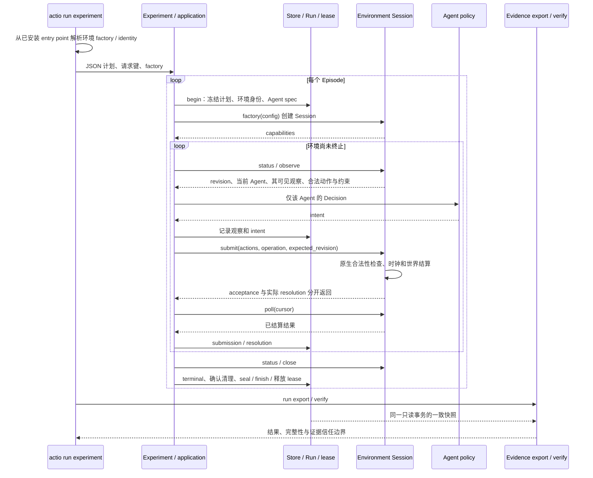

# 第一阶段 Environment Session（2026-10-30）

当前路径与 LLM 选项已改为 [TOML 配置](CONFIGURATION.md)，下面的 `.local` 和父目录 `t` 是默认示例；可在 actio.toml 中更改，不再作为密钥查找的硬编码依据。

Actio 负责实验调度、Agent 决策调用、Run/lease、审计和结果收集；环境拥有世界、合法性、行动者顺序、时钟和结算。当前新增通用同步实验入口，同时保留原 DSH + Concordia CLI 和证据合同。未改演化算法、Memory、Ledger 规则，也未引入 OpenRA 依赖。

## 实际控制与数据流



源码：[协议](../../src/actio/contracts/environment.py)、[实验编排](../../src/actio/application/experiment.py)、[注册装配](../../src/actio/interfaces/environments.py)、[独立证据检查](../../src/actio/evidence/bundles/environment.py)。

## 最小协议与能力

| 操作 | 行为与边界 |
|---|---|
| `factory(config)` | 创建一个独立 Episode；工厂在部分创建失败时负责清理已获得的资源 |
| `observe() -> Frame` | 只读；给出 revision 和零个或多个 Decision，各自只含该 Agent 可见的 observation、legal_actions、constraints |
| `submit({agent: action}, operation, expected_revision)` | 支持一个或多个 Agent；回执 status 为 accepted/rejected/pending，另附已发生的 outcomes；同 key 同输入幂等，冲突拒绝 |
| `poll(after)` | 读取 cursor 之后的真实结算，不能拿 accepted 代替世界效果 |
| `status()` | terminated/truncated、原因及环境原生结果；终止后没有待行动者 |
| `close()` | 幂等；确认清理，或明确抛错 |

能力字段声明同步/异步、多主体、同时行动、snapshot 及 clock 类型。两个当前 adapter 均为多主体轮流同步环境，snapshot=false、asynchronous=false；不提供空快照。协议可以表达 pending/多 Agent intent，第一阶段 runner 明确只接受同步、每次提交一个聚合 Resolution 的环境。没有把异步轮询、部分 batch 成功、快照恢复宣称为已验证功能。

数据沿用 Actio 的受限 JSON：可序列化的字典、列表、字符串、布尔、null 和安全整数；动作枚举为 tuple 时在持久化时编码为列表。后续有浮点数据的 adapter 应明确固定精度或字符串编码，不更改历史 canonical/hash 合同。方法应有期限；当前原生 Concordia 队列等待 30 秒、close join 5 秒。实验 driver 还检查动作数和墙钟期限，但不能强行中断任意第三方工厂或阻塞方法；需要强隔离的外部环境应使用受管进程。

## PettingZoo：真实第二环境

`pettingzoo.tictactoe.v3` 接入未修改的 `tictactoe_v3.env()`。PettingZoo 决定 agent_selection、棋盘、action_mask、胜负、reward 和 termination。adapter 只转换 observation 数组和回执；规则 Agent 每次选第一个合法动作。adapter 在 dispatch 前拒绝非法 intent，棋盘不变；这是 Actio adapter 的准入语义。直接调用 PettingZoo 的非法动作惩罚规则没有被重写。

参考官方 [TicTacToe 文档](https://pettingzoo.farama.org/environments/classic/tictactoe/)与 [AEC API](https://pettingzoo.farama.org/api/aec/)。实际复现固定 PettingZoo 1.24.3、Gymnasium 1.0.0、pygame 2.6.1 和根 requirements.lock 的 NumPy。旧 classic extra 固定的 pygame 2.3.0 缺少本次 Python 3.12 安装所需 wheel，构建 SDL 时失败；仅安装本环境必要依赖即可运行，无需换成自制棋盘。

安装（仓库根、Windows x64，Python/环境/缓存/演示产物在本项目 `.local` 内；旧 DSH 回归使用父目录 `D:\Work\5\actio\t` 作为短运行根，避免超过原生 80 字符保护）：

```powershell
pwsh -File scripts/environment_setup.ps1
$env:UV_CACHE_DIR="$PWD/.local/uv-cache"
$env:UV_PYTHON_INSTALL_DIR="$PWD/.local/python"
$py='.local/phase1-env/Scripts/python.exe'
uv run --no-project --python $py python -m actio run --db .local/demo.sqlite init
uv run --no-project --python $py python -m actio run --db .local/demo.sqlite experiment --key demo --config examples/environments/tictactoe.json
uv run --no-project --python $py python -m actio run --db .local/demo.sqlite export demo:0 --output .local/demo-bundle
uv run --no-project --python $py python -m actio verify .local/demo-bundle
uv run --no-project --python $py python -I -B tools/refactor/validate.py environment --output .local/environment-check
```

使用新的 DB/导出/检查目录名；同一 experiment 请求键重放直接返回已存 Run，不重新执行。修改计划后应换 key。每个 Episode 对应一个现有 Run，request 记录相同 experiment key、完整计划和 Episode index；没有另造 Experiment 数据库或并行 lease。相同 seed 的三局是链路验证，不是统计独立样本。

## 注册新环境

由扩展包声明标准 Python entry point，安装后仅配置环境名；应用层不导入环境模块、不添加分支：

```toml
[project.entry-points."actio.environments"]
"your.environment.v1" = "your_package.adapter:create"
```

`create(config)` 返回 EnvironmentSession，可附 `create.identity()` 提供原生版本/pins。Actio 记录 entry point、distribution/version、已安装源码 hash 和 backend identity，拒绝未知及重名注册。配置不能指定任意模块路径。当前仅规则策略 first-legal；外部 Agent 策略可通过用例注入，但 CLI 仍有意不加载任意 Agent 代码。测试用独立 distribution metadata 注册新环境名，并通过同一 experiment 用例运行，不修改核心。

通用规则实验的 Run `task=success` 表示实验交互完成，环境的输赢、reward、truncation 或任务结果保存在 terminal.results；不能据此认定所有 Agent 获胜。旧 solver 路径仍按既有任务协议区分 success/task_failure。

## Concordia 兼容路径与架构决策

1. **保留原生执行器。** 以前 `run_engine` 内的 External Entity 直接调用 RuntimePort，再由 GM 写 SQLite。现在 `ConcordiaSession` 在专用线程运行固定源码的 `Sequential.run_loop`；Entity.act 发布 Decision 并等待 intent。原生 Engine 继续 make_observation、next_acting、resolve 和推进；通用协议没有 GM、ActionSpec 或 Concordia 内部方法。
2. **控制面留在原线程。** 兼容 `run_engine` 驱动新 Session，在主线程调用现有 DSH RuntimePort/TransportPort、Facts.certify、Store world/domain_receipt、confirm_effect 和 close。SQLite 连接不跨线程；Entity.observe(EVENT) 采集的真实事件被传回，不能以 resolve 返回 None 充当结果。保留旧 actor 顺序、累计私有观察、ActionSpec、任务卡、manifest 和终态合同。
3. **区分来源。** 旧路径仍有 DSH stream/occurrence/operation、Ledger 发送/usage 与原生来源证明。规则 Agent 使用 Store 的 audit/scenario_terminal，证据格式为 environment-session.v1；不伪造 native journal 或把规则动作写成 DSH 事实。规则路径没有模型发送，因此不创建空的第二 Ledger。
4. **失败不伪回滚。** native 世界结算与 Store 写入不构成跨系统事务。结算后落库失败会留下失败/不完整证据；不自动重发。策略/工厂/期限错误清理后结束 infrastructure_failure；清理未确认时保留 lease，并同时记录主因与 cleanup_failure。Concordia 等待行动时可通过取消哨兵结束线程；这不证明外部副作用或任意原生阻塞可撤销。
5. **保持旧预算。** 原有两步 DSH fixture 的 worker/operation 限制不扩张；多轮规则实验不经过该专用 RuntimePort 配额。后续多轮模型 Agent 需要独立明确的 runtime 会话/调用预算策略，不能顺手删除原有限额。

原始 `EpisodePorts.environment` 回调改名为类型 `LegacyEpisodeDriver`，仅表示兼容编排，新的 Session 协议单独位于 contracts/environment.py。`run social` / `run schedule` 和已有 transport/campaign 均继续经兼容入口进入新 Session。

## OpenRA 下一阶段

OpenRA 不属于本轮运行依赖。下一阶段需要确认可受控的服务端/进程入口和版本，设计地图、mod、seed、玩家槽与 Episode 配置；把玩家可见状态和战争迷雾映射成 Observation，把 order/命令可用性映射成动作约束。原生游戏服务端拥有 tick、单位规则、命令接收及最终生效；Actio 不重写游戏逻辑。

实时模式还需实现 asynchronous/pending 的提交与 cursor 轮询、tick/revision 对齐、多个玩家同 tick 命令批次、幂等和断线后的未知接收状态；扩展当前同步 runner 后才能启用。通过受管进程/Windows Job 管理端口、超时、崩溃、终止与清理，记录版本及 replay/结果证据；仅在验证原生存档覆盖范围后声明 snapshot/restore。先用规则或脚本 Agent 完成一场真实对局，再考虑模型 Agent 的 DSH 会话和 Ledger 成本接入。
