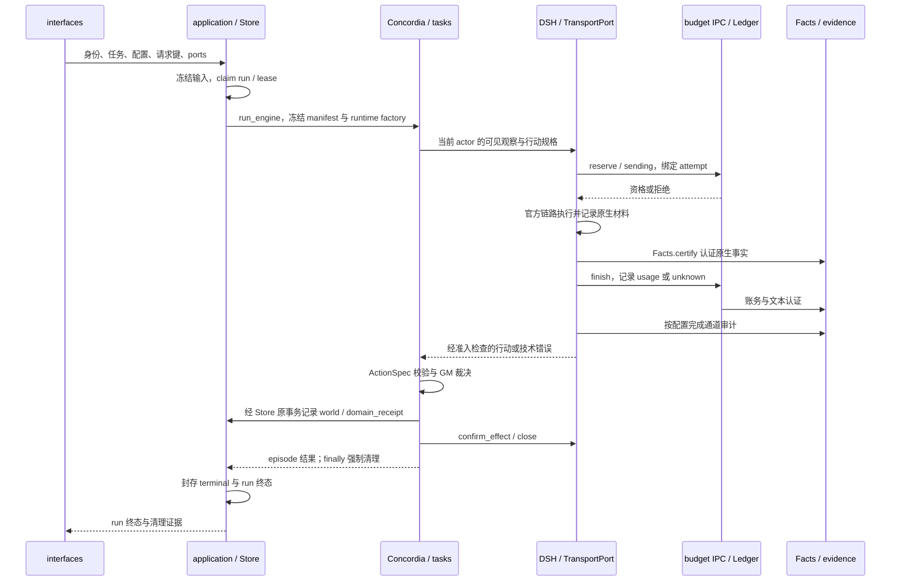
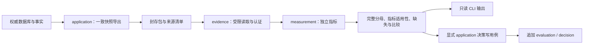

# 三条关键流程

返回[系统一页图](README.md)。这里只描述当前行为，版本特定合同和历史实验结果以 `docs/validation/` 下的固定记录为准。

## 1. 执行一个 solver episode

入口装配位于 `interfaces`，主要编排位于 `application.transport`，实际能力由 `EpisodePorts` 注入。

双 seat solver 按 A → B 执行，B 使用本臂实际 A 的公开历史；A 技术失败时，B 按冻结合同保持 not_run。早期 fixture 场景也有自己的顺序，不能把此图当成所有历史版本的统一调度。

图中展示成功主路径的职责关系；具体认证与结算在 TransportPort、Ledger 及 Facts 内完成。solver 写 world/domain_receipt；助手 fixture 的 memory 写入另由 application.memory 处理，并非每次 solver 行动都写长期记忆。

三种结果分别记录：协议/事实是否可信、行动是否符合规则、任务是否达成。可信的非法行动是行为结果，证据缺失是技术问题。finally/失败路径保留主因和清理错误；unknown 不清零、不隐式补样。

**事务边界：** Store 的领域写入与 Ledger 的发送状态各自保持原连接和事务。Worker、外部发送、两库之间没有原子事务，也没有完整 controller 恢复承诺。

代码入口：[transport](../../src/actio/application/transport.py) → [wiring](../../src/actio/interfaces/wiring.py) → [原生适配](../../src/actio/adapters/transport/transport.py)；账务入口是稳定的 `python -m actio.interfaces.ipc.budget`。

## 2. 导出、只读核验与评估

读流程只认证与计算，不直接推进候选状态。写流程把结果关联到对应 evaluation，保留旧 decision；当前 `activation=false`。artifact 不能指定任意可执行 reader，历史核验由可信代码选择固定 Git 版本。

结构完整、行为错误、指标适用性和研究有效性分别判定。配对缺失仍留在完整计划分母中，重新组织代码不会产生新的研究证据。

代码入口：[export](../../src/actio/application/export.py)、[verify](../../src/actio/evidence/bundles/verify.py)、[evaluation measurement](../../src/actio/evidence/campaigns/evaluation_measurement.py)、[evaluation store](../../src/actio/application/evaluation_store.py)。

## 3. C5 本机故障诊断

`interfaces.cli.transport_diagnostics` → `application.diagnostic_runtime` → `DiagnosticPorts` → 官方 Worker + 有显式 response_policy 的本机 fixture → 保留 attempt/usage/unknown → 回收 → `evidence.diagnostics.failure_observation` / reader 离线复算。

这是九场景工程诊断。R7–R10 最终正式矩阵的 12 sends、5 settled、7 unknown、6 not_run 只描述该轮受控验收；不能推出 provider 可靠性、真实费用或 C4 完成。新目录重构应建立自己的源码身份与运行收据，不能沿用旧矩阵冒充新 wheel 验证。

本机 priced rehearsal 可使用显式 fixed Clock；live/system 必须用真实 UTC，过期报价仍拒绝。Clock 进入配置、Ledger、snapshot 和 TS→Python IPC，同一账务权威不变。不能为了让测试通过而更新旧报价或全局冻结时间。

代码入口：[诊断 CLI](../../src/actio/interfaces/cli/transport_diagnostics.py)、[runtime 编排](../../src/actio/application/diagnostic_runtime.py)、[失败观察](../../src/actio/evidence/diagnostics/failure_observation.py)。

## 使用与结果边界

实际命令、最小 wheel 和只读 guard 复现方式见[验收 CLI](../validation/refactor_entrypoints/CLI.md)。历史 C5/C4 用固定版本重放，不能把历史命令中的私有 import 直接套在当前源码上。

R7–R10 的同一最终 wheel 已完成 34 suites、164 个方法；首次失败和同条件隔离重测均保留，详见[结果](../validation/refactor_modularity/RESULTS.md)。本次文档审阅未重新执行这些运行测试，也未调用真实模型。
