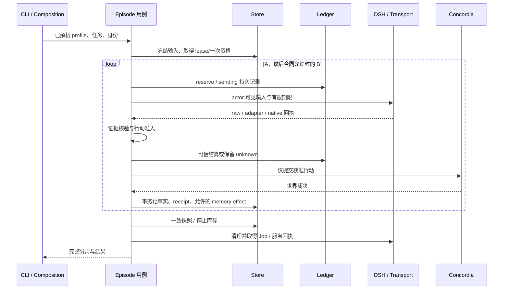

# 模块、接口与流程

这是[简明架构](README.md)的目标设计。路径名称可在实施时按真实依赖微调，状态所有权、纯核验边界和以下依赖方向必须成立。

## 目标代码树

```text
src/actio/
  __init__.py / __main__.py
  contracts/        canonical、封包、基础 schema、错误
  domain/           identity、memory、facts、attempt、lineage 规则
  tasks/            scheduling、bargaining、visibility、任务版本
  profiles/         显式版本注册表、冻结计划、阶段差异
  application/      ports、episode、campaign、memory、evaluation、diagnostics 用例
  adapters/
    persistence/    Store / Ledger / SQL / migration / snapshot
    runtime/        DSH / host / Windows Job / MCP / 原生 journal 读取
    environment/    Concordia Engine / Entity 接线
    transport/      官方传输接线、MJS guard、loopback fixture
    filesystem/     原子导出、受限读取、源码身份与资源访问
  measurement/      independent oracle、metrics、denominators、diagnostics
  evidence/         stream/channel audit、verify、history registry
  interfaces/       CLI、worker/IPC 入口、composition
  _vendor/          最小上游摘取及完整来源/许可
  <兼容入口>.py     仅为已登记的旧 CLI/IPC 提供薄转发
tests/
  unit/  contracts/  integration/  history/  architecture/  packaging/
  support/          测试共用构造器、guard、进程辅助程序
tools/
  bootstrap/  verify/  release/    当前维护的安装/核验/发布工具
scripts/            旧阶段脚本保持历史路径；README 标出维护状态
docs/
  architecture/     当前三篇设计文档和结构清单
  validation/       原各阶段冻结材料；新增 refactor_modularity 验收
```

树描述组织方式，不要求提前创建空目录。`profiles` 保留有语义差异的版本，不把所有旧逻辑复制成一个新的平铺仓库；相同机制进入核心，旧 schema 的差异仍由显式版本实现表达。历史脚本继续留在原路径，以免破坏受控证据的工具 hash；当前产品和当前测试不依赖它们。

## 依赖规则

| 包 | 可以依赖的项目内包 | 禁止承担的副作用或反向依赖 |
|---|---|---|
| `contracts` | 无 | 不访问文件、环境变量、数据库、网络、runtime |
| `domain` | contracts | 不导入 Store、Ledger 或 SDK，不持有连接 |
| `tasks` | contracts、domain | 不导入 measurement/oracle、应用编排、环境 runtime |
| `profiles` | contracts、domain、tasks | 不探测当前 Git/文件系统，不导入 transport/Ledger；源码身份由调用方传入 |
| `measurement` | contracts、domain、tasks 的数据/可见性定义；受限 `_vendor` | 不调用生产世界裁决函数作为独立 oracle；不读 key、网络、DB 或启动 Worker |
| `evidence` | contracts、domain、tasks、measurement | 不发请求、不写领域/账务状态、不根据 artifact 加载可执行 reader |
| `application` | 上述纯包及自身 `ports` | 不导入具体 adapters，不直接写 SQL/调用 SDK；不接受任意 artifact 指定的实现类 |
| `adapters` | 纯包与 application.ports | 不导入 application 的用例实现、interfaces、tests 或 scripts |
| `interfaces` | 上述包 | 只解析、装配、调用；不内嵌评估、事务或业务判定 |

`_vendor` 保持小而固定，仅供必要适配/解析使用。`application/ports.py` 是纯协议声明，不导入应用用例；不能用 `application/__init__.py` 的批量 re-export 造成隐式反向依赖。顶层业务包之间无环；历史源码仅在独立固定 checkout/安装中执行，不算当前代码的循环依赖豁免。

代码中的默认选择由 `interfaces/composition` 装配，边界例如：

- `DomainUnitOfWork`：在一个 Store 连接内提交 occurrence/projection、world receipt、memory/effect 或谱系变更；接口是业务操作，不暴露任意 SQL。
- `AttemptLedger`：保留 authorize/reserve/sending/response/settled/unknown 现有条件和一次资格。发送前持久化，失败后不可凭诊断改写结算。
- `AgentRuntime` / `Environment`：前者返回官方执行回执，后者接受通过准入的行动并裁决环境；二者互不代替。
- `EvidenceSource` / `ArtifactSink`：受限读取原生/导出材料与写入新导出目录。纯核验函数消费 bytes/值，由外层负责 I/O。
- 只有现有测试需要替换时才引入 `Clock` / `ProcessIdentity` 等小接口。禁止为每个函数制造抽象工厂或万能 repository。

接口名称是设计建议；具体签名由现有调用方推导。用最小方法表达现有行为，保留事务粒度和失败传播，禁止借重构新增能力。

独立 oracle 可以共享任务的不可变数据结构，不能共享生产裁决、收益计算或合法性判定实现；以测试阻断这些调用，避免重构抽取“公共函数”时把两条验证路径合成同一条。

## 各模块内部流程

| 模块 | 内部处理顺序 | 所有权与验收重点 |
|---|---|---|
| contracts | 受限解析 → 字段/类型校验 → canonical 编码 → seal/digest | 不改变 UTF-16 键序、整数范围、重复键/非有限值拒绝或 canonical 字节 |
| domain | 已有状态 + 命令 → 权限/版本/幂等判断 → 待持久化转移 | namespace、revision、lease/fence、once-only 和 append-only；不提交事务 |
| tasks | 固定卡 → seat 可见投影 → 行动解析 → 世界约束与结果 | 公开/自身信息边界；评分器不反过来给 solver 提供隐藏解 |
| profiles | 显式版本键 + 固定参数 + 当前实现身份 → 校验 → 有限计划 | 禁止猜测 schema、自动 fallback、旧协议静默升级或扩大允许域 |
| application | preflight → 冻结/资格 → A → 条件允许时 B → 保存/导出 → 清理 | 真实 A 历史、阶段停止条件、未执行后缀、异常路径的清理 |
| adapters | 端口命令 → 具体资源操作 → 完整事实/受控错误返回 | Windows Job、短路径、DSH/MCP、SQLite WAL、resource 打包和 TS→Python IPC |
| measurement | 已认证输入 → 独立 oracle/失败观察 → 逐项适用性 → 分层聚合 | 合法性/行为错误/技术缺失分开；null 不补 0；诊断不决定结算 |
| evidence | bytes/对象 → schema/来源绑定 → 通道/行间一致性 → 核验结论 | raw/adapter/native 和 trust registry；合成投影不冒充历史 raw 认证 |
| interfaces | 参数 → 选择受信 profile/reader → 最小依赖装配 → 输出/退出码 | 只读命令无 runtime 导入，错误不泄密，旧 CLI 和子进程调用仍工作 |

## 流程一：一次双 seat 执行



这是职责顺序示意，实施时以原事务/期限/发送 gate 的细节为准，不能按图重新排序跨库提交。A 技术失败则 B 为 not_run；B 失败不抹去已经发生的 A。reasoning 仅在受控审计路径出现，不进入领域行动或 memory。

## 流程二：离线核验与候选评估

外层受限读包 → evidence 核验完整性及来源 → measurement 独立计算 → application 检查 evaluation 的 plan/claim/候选绑定 → Store 追加 evaluation decision → 导出 lineage。纯 `verify` 到核验结果即结束，不取得执行资格、不写决策。

旧包先由代码维护的受信注册表确定固定 reader。需要 Git archive 或子进程时，由 `tools/verify` 外层执行；内层 reader 保持只读 guard。读不到受控材料要报告 BLOCKED，不把公开 summary 当作原始证据。

## 流程三：流错误与停止

观测 HTTP/SSE/adapter/native → 保存原始 attempt、usage 或 null → 原合同决定停止/unknown → 清理 Worker/服务 → 纯诊断分类 → 完整 assigned/attempted/sent/admitted/not_run 分母。`provider_error_observed` 只说明收到结构化声明；不推断是谁造成、可否重试或是否收费。

C5 本机矩阵由应用诊断用例驱动，fixture 服务实现放在 `adapters/transport`；`tests/support` 可以复用产品公开 fixture 接口。产品不能再通过修改 `sys.path` 导入测试实现或 monkeypatch 测试服务器。
