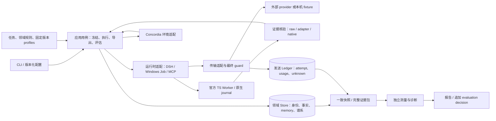

# Actio-RSI 简明架构

**状态：2026-10-11 的重构设计，尚未实施。** 审阅基线为 C5 `c5aeec2e4f99b99da4fda5cb6cc59476ce0be890`。本轮暂停实验迭代，先整理模块、保留既有行为并重新验收。当前实现与下图中的目标边界不能混为一谈。

只需依次阅读三篇：本页说明系统；[模块与流程](MODULES.md)说明职责和输入输出；[迁移与验收](REFACTOR_PLAN.md)说明如何落地。执行者使用[完整重构 Prompt](../prompts/modular_architecture_refactor.md)。逐文件证据见 [inventory.json](inventory.json)。

## 系统解决什么问题

Actio 把“持久 Agent 在受控任务中行动”变成可记录、可复核的过程：冻结身份和任务 → 调度执行 → 核验实际输入输出 → 环境裁决 → 保存事实与记忆 → 独立测量 → 追加评估与决策。候选修改可以被比较，但没有充分证据就不能激活。

当前是 **Windows 单机模块化单体的重构目标**。继续复用官方 DSH Python SDK/TS Worker `0.1.5rc1`、固定 Concordia Engine/Entity、SQLite 和已有独立评估代码；不引入微服务、消息总线、ORM、通用插件平台或第二状态权威。

## 整体运行架构

图中的箭头是运行数据流，不是 Python import 方向。严格依赖规则见[模块与流程](MODULES.md)。本次重构验收只使用本机 fixture；图中的外部 provider 是既有能力，不是本轮执行目标。

## 三个状态权威

| 权威 | 持有的事实 | 不由它决定的事情 |
|---|---|---|
| 领域 SQLite Store | Agent/spec、run/lease、来源 occurrence/projection、world receipt、memory revision/effect、candidate/evaluation/decision | 不写 DSH 原生 journal，不把 JSON 导出变成另一数据库 |
| 发送 SQLite Ledger | 请求资格、reservation、sending、response、可信 usage、settled/unknown | 不推断供应商实际账单，不把 unknown 改成零费用 |
| DSH 原生 session/journal | 官方 runtime 的实际输入、事件、输出 | 不作为 Actio 领域状态或评估决策的权威 |

Store 内部需要原子的多表操作继续在同一事务中完成。Store 与 Ledger 的跨库过程保留现有资格、幂等和失败证据，不宣称获得分布式原子性或完整 controller 恢复。

## 核心模块

| 模块 | 一句话职责 | 主要输出 |
|---|---|---|
| `contracts` | 纯数据、规范编码、封包与底层校验 | 稳定 canonical bytes、digest、结构化错误 |
| `domain` | 身份、事实、记忆、发送与谱系的业务约束 | 合法状态转移和不变量判断 |
| `tasks` | 任务规则、actor 可见观察、合法行动、世界裁决 | TaskSpec、Observation、WorldResult |
| `profiles` | 已有版本的固定任务/执行配置和有限计划 | 经过验证的 Profile / Plan |
| `application` | 编排一次执行、故障停止、导出与评估 | 用例结果、事务请求、清理回执 |
| `adapters` | 实现数据库、DSH、Concordia、进程和文件接口 | 外部事实、持久状态和受控 I/O |
| `measurement` | 独立 oracle、指标、分母与失败观察 | 不修改原始事实的测量结果 |
| `evidence` | 来源绑定、通道一致性、历史信任和离线核验 | 验证结论、可复核的证据投影 |
| `interfaces` | CLI 解析和唯一组装入口 | 稳定命令、退出码、依赖装配 |

这些是职责包，不是九个服务，也不要求每个包都建立相同的多层目录。仅在已有替换边界定义少量接口；函数足以表达的纯逻辑继续使用函数。

## 输入与输出

| 用例 | 输入 | 输出与边界 |
|---|---|---|
| 执行一个 episode | 冻结身份/spec、任务、profile、A/B 顺序、当前 memory revision、执行资格 | A/B 实际行动、世界 receipt、attempt 与 usage、原生证据、停止原因；B 只收到本臂实际 A 的公开行动 |
| 保存事实/记忆 | 有来源绑定的事件、namespace、预期 revision | 去重后的 occurrence/projection、事务化 effect 和新 revision；私有信息不能越权共享 |
| 离线评估 | 完整计划、经过认证的执行证据、固定指标版本 | seat/episode/各类 pair 的完整分母、null 与原因、报告；技术缺失不变成行为失败 |
| 候选决策 | 固定 proposal、独立 evaluation、报告与准入策略 | 追加的 decision/lineage；历史记录不被覆盖，当前 activation=false |
| 失败诊断 | 受限 raw/adapter/native 材料与原账务状态 | 供应商声明错误等观察；不授予重试、不结算 unknown、不推断上游责任 |

## 已完成与本轮目标

C5 的 9 场景/12 次本机发送已发生，最终 PASS 来自原实测证据的离线重算，不能称为最终源码重新运行。本轮审阅额外验证了现有 12 项纯测试和公开合成包的只读核验，未启动 Worker，未进行 provider 调用。

接下来的重构必须同时交付：清晰目录和依赖边界、兼容入口、独立 wheel 安装、旧证据的固定 reader、新源码下的本机 DSH/Concordia 实测、更新后的三篇设计文档。实现完成后，本文状态才可改为“已实施”，并链接实际测试和提交。

C4 仍 INCOMPLETE，C1 仍 infrastructure_failure；真实生成尝试累计 172，目录 GET 1。费用/账单及上游身份未核实，binary_source_mapping=unproven，full_controller_recovery=unsupported，研究有效性 UNESTABLISHED，activation=false。这些限制不因目录重构改变。
