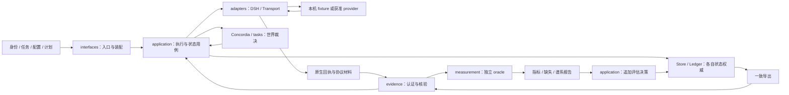

# 系统一页图

Actio-RSI 是研究 Agent 持久身份、社会交互和受控改进的**模块化单体**。它把执行输入、模型行动、环境效果、事实与记忆、独立测量和版本决策连接起来。运行形态是 Windows 上的 Python 控制面、受管 DSH Worker、Concordia、SQLite 与文件证据。

本文描述已实现的结构，代码基线为 [`041ade0`](https://github.com/ChaunceyKung/Actio-RSI-infra/commit/041ade0b83456e329e85e70b4004ddb9f05f1b1c)。R7–R10 工程验收已通过；实验停在 C5，未开始 C6。下一轮目录方案见[审阅与计划](../reviews/modularity_r11_r14_review.md)，不能把拟议目录当成已经落地。

## 输入与输出

| 输入 | 处理 | 输出 |
|---|---|---|
| 身份/spec、任务卡、授权记忆、候选、冻结计划与配置 | 检查合同 → 取得资格 → 受管执行 → 认证行动 → 环境裁决 | run、原生回执、领域事实、world/memory effect、发送与 usage 台账 |
| 导出证据包、固定历史信任信息、评估计划 | 只读核验 → 独立指标 → 完整分母比较 | 核验报告、指标与缺失原因；持久化 decision 另走写用例 |

## 运行关系

箭头表示数据流或调用关系，不是完整的 Python import 图。



## 从目录找职责

```text
src/actio/
├── contracts/     数据格式、受限编码、wire、最小运行端口
├── domain/        状态规则、namespace、账务规则与 Clock
├── tasks/         任务 family、可见性、合法行动、版本 registry
├── measurement/   独立 oracle 与诊断指标
├── profiles/      运行模式、配置构造、纯校验、版本选择
├── evidence/
│   ├── audit/ bundles/ campaigns/ lineage/ diagnostics/
│   └── failure_observation.py  公开兼容 reader
├── application/   episode、memory、campaign、评估与导出用例
├── interfaces/    参数解析、可信选择、Store 与 ports 装配
├── adapters/
│   ├── persistence/  SQLite、SQL 资源、Ledger、迁移
│   ├── runtime/      DSH、Worker、Job、MCP、原生事实、清理
│   ├── environment/  Concordia Engine 接入
│   ├── transport/    请求适配、TS plugin、可安装本机 fixture
│   └── filesystem/   文件、身份闭包、受控导出与凭据接入
├── _vendor/       窄复用组件及来源/许可
├── pins/ 与 *.json  固定依赖、报价及历史信任资源
└── *.py           19 个登记兼容薄层，另有 __init__/__main__
```

根层保留 `actio.budget`、`actio.host` 等，是因为 CLI、子进程和 IPC 仍使用这些地址。新内部代码应导入实际 owner，不能依靠兼容层绕过边界。入口清单见[兼容合同](../validation/refactor_modularity/compatibility.json)。

## 状态由谁拥有

| Owner | 权威状态与边界 |
|---|---|
| Python Store | 身份、run/lease、领域事实、memory、候选及 evaluation；相关多表写入保持同一个 SQLite connection/事务 |
| 发送 Ledger | 授权、reservation、attempt、usage、unknown；一次失败不自动产生重发资格 |
| DSH | 原生 session、loop、journal；控制面记录关联和回执，不另造原生 journal 写者 |
| Concordia / 任务规则 | 行动合法性、环境推进及 world effect；Agent 输出不是最终裁决 |
| 文件报告 | 上述状态的受控快照与核验结果，不构成第二数据库权威 |

Store 和 Ledger 各有事务，不宣称跨库原子提交。`interfaces.store.Store` 仍组合 `Connection` 与包含 SQL 的 `StoreOperations`；目前不是可任意替换数据库的完整 Repository/UoW 抽象。`profiles` 的 validators 纯净，构造器仍会读取源码身份；`evidence` 也有文件读取，不能将整个包称为无 I/O。

## 继续阅读

- [模块卡片](MODULES.md)：每个模块的输入、内部处理、输出、代码入口与约束。
- [三条关键流程](FLOWS.md)：episode、离线评估、C5 失败诊断。
- [R7–R10 迁移记录](REFACTOR_PLAN.md)与[验收结果](../validation/refactor_modularity/RESULTS.md)：测试、wheel、清理、失败和复核证据。
- [R11–R14 目录整理计划](../reviews/modularity_r11_r14_review.md)与[下一 session Prompt](../prompts/refactor_directory_r11_r14.md)：后续工程范围。

模块图无环只证明已扫描 import 的结构，当前检查器没有覆盖所有语义耦合。完整 controller 恢复、二进制源码映射及研究效度仍未建立，候选保持不可激活。历史 manifest 按对应固定提交核对；本文作为导航可更新，不能据此刷新旧证据 hash。
