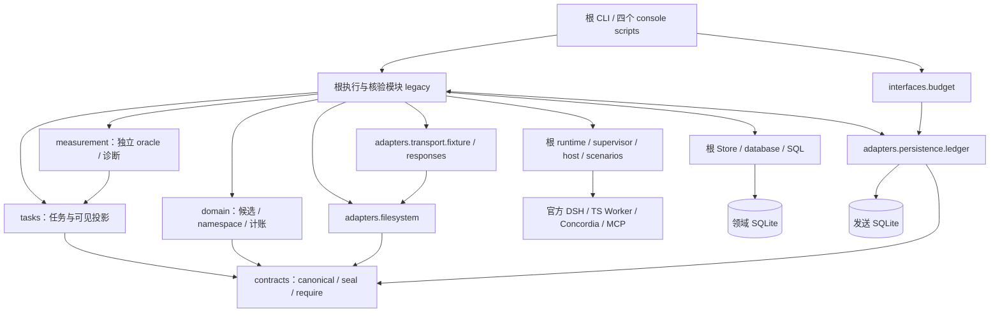

# Actio-RSI：当前实际架构

本轮工程状态 **INCOMPLETE**。产品冻结提交 `d64264f` 已拆出纯合同、任务、部分领域规则、独立 oracle、文件和 Ledger 适配器及可安装的本机 fixture；完整九层设计尚未落地。新 wheel 的本机实测通过不等于全局架构验收通过。[验收结果](../validation/refactor_modularity/RESULTS.md)列出各项证据和缺口。

继续实施请先读[续作计划](CONTINUATION_PLAN.md)，并使用[完成 Prompt](../prompts/modular_architecture_completion.md)。当前未完成的主要问题是任务/profile/账务循环、根实现模块和 readiness rehearsal 的可重复时钟；历史实验与报价材料保持不变。

Actio 在 Windows 单机上复用固定 DSH SDK/官方 TS Worker、Concordia 和 SQLite，记录 Agent 行动、世界裁决、记忆及发送账务，再进行只读核验和独立测量。它不具备训练、自动激活、原生 resume/fork 或完整 controller 恢复能力。

## 实际模块图

下图表示当前主要依赖，`legacy` 是图中对仍在包根目录的实现的统称，**不是代码中新建的包**。双向箭头保留真实耦合；图没有宣称 DAG。全部 89 个 Python 模块、403 条依赖及每个 SCC 见 [architecture.json](../validation/refactor_modularity/architecture.json)。

当前最大 SCC 由基线 33 节点减为 23；还存在 7、3、2、2 节点 SCC。新纯包不依赖基础设施，产品不再依赖 tests/scripts，但 tasks 内部仍有多版本互相分派。`application`、`profiles`、`evidence` 尚未形成目标职责包，业务端口尚未完整定义。三篇文档描述现状及剩余工作，不把计划目录当成实现。

## 状态权威与 I/O

| 权威 | 所有者及事实 | 边界 |
|---|---|---|
| 领域 SQLite | 根 `Store`、`database`、candidate/evaluation store：身份、run、lease/fence、occurrence/projection、world receipt、memory revision/effect、谱系 | 原连接与多表事务不变；旧库只读；迁移写新副本 |
| 发送 SQLite | `adapters.persistence.ledger.Ledger`：资格、reservation、sending、response、usage、settled/unknown | 原事务体、一次资格和 unknown 语义保留；纯预算规则仍在根 budget，反向依赖未消除 |
| 官方原生 session/journal | DSH Worker，经根 runtime/supervisor/host 接入 | 不是领域或账务的替代数据库；证据导出也不是新状态权威 |

数据 schema、SQL、历史信任注册表未改。当前实现身份覆盖安装产品 Python/MJS/SQL/JSON 和必要许可，wheel 另有整包 SHA256；profile 仍自行读取文件计算身份，尚未完成外层验证后显式注入。历史材料用固定旧 commit/reader 认证，未改旧 freeze/pins。

## 导航与限制

[模块及三条实际流程](MODULES.md) · [迁移状态与验收](REFACTOR_PLAN.md) · [当前命令](../validation/refactor_modularity/CLI.md) · [逐文件迁移](../validation/refactor_modularity/migration-map.json) · [兼容入口](../validation/refactor_modularity/compatibility.json)。`inventory.json` 保留原审阅基线并追加当前状态，不作为运行信任根。

最终安装实测为新 9 场景 / 12 次 loopback；5 settled/usage/admitted，7 unknown，6 not_run，12 Worker、9 服务/端口清理。历史 C5 的最终 PASS 仍是原实测的离线重算，与本轮新运行分别记录。

本轮真实 provider/目录 GET/外部 MCP 均为 0。历史生成 172、目录 GET 1，C4=INCOMPLETE、C1=infrastructure_failure、activation=false、研究有效性 UNESTABLISHED、binary_source_mapping=unproven、full_controller_recovery=unsupported；账单/币种及上游身份限制不变。
