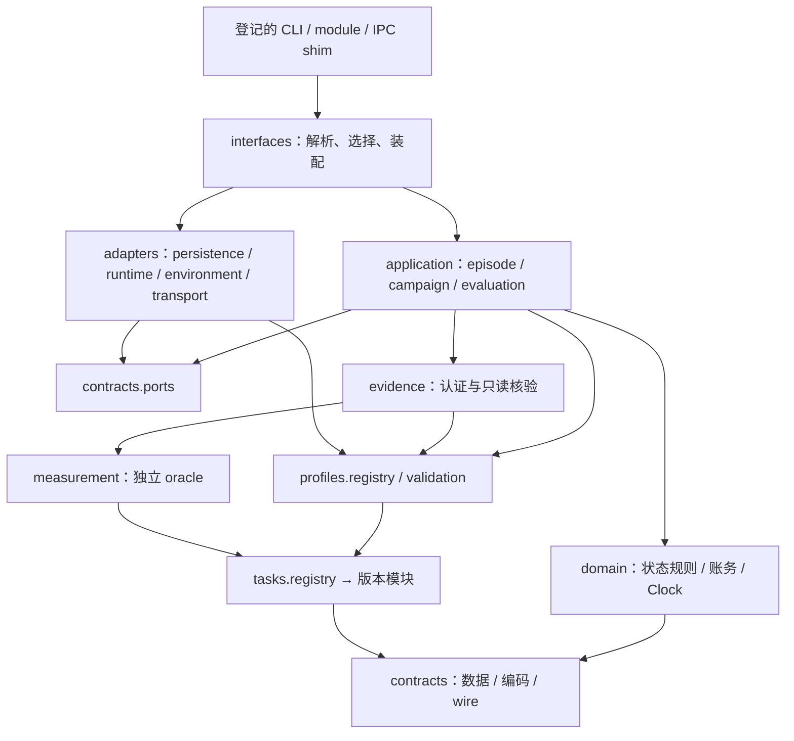

# Actio-RSI 模块化架构

R7–R10 已完成，**工程验收 PASS**。同一最终 wheel 的34 suite、164个唯一方法通过；一次ready超时按原条件隔离复核，原失败保留。当前真实 AST 扫描为 163 个 Python 模块、594 条依赖，SCC=0、未迁移根实现=0、违规=0。检查器未修改，继续扫描函数内和 literal dynamic import。

这是模块化单体。同一 Store 仍以同一个 SQLite connection 完成多表事务；Ledger 保留原 authority anchor、WAL、readonly、BEGIN IMMEDIATE 和 unknown 语义。端口由真实调用点产生，没有引入第二 Ledger、多个 repository 或分布式事务。

`interfaces.wiring` 注入 EpisodePorts / DiagnosticPorts；application 不导入 runtime、environment、transport、persistence 实现或子进程。文件输出仍由窄 filesystem 工具提供。profile 的纯 validators 只依赖 contracts/domain/tasks；版本构造器仍读取完整本机源码身份，未把这部分误称为纯业务验证。纯 evidence reader 不导入 application、runtime、数据库写入器，也不执行 artifact 指定的代码。

ClockSpec 是显式合同：live/system 读取真实 UTC；仅 priced_rehearsal 接受 fixed instant。默认 `2026-10-09T00:00:00Z` 位于原报价窗口内。新 schema `pilot-config.v4-clock.v1`、profile `sdk-minimal+actio-priced-memory.v2` 与旧 reader 可区分；Clock 进入配置 hash、Ledger meta、snapshot 和 TS→Python IPC 的同一账务权威。旧 quote 没有更新。

模块职责见 [MODULES](MODULES.md)，迁移见 [REFACTOR_PLAN](REFACTOR_PLAN.md)，验收与限制见 [RESULTS](../validation/refactor_modularity/RESULTS.md)。停止在工程重构，C6、真实 provider、judge、训练、部署和激活保持暂停。
