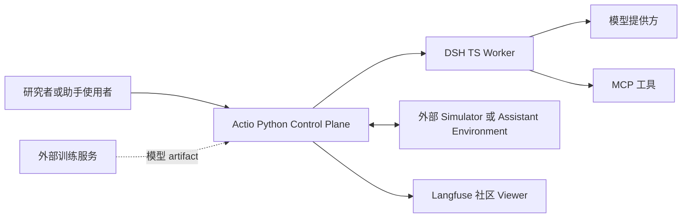
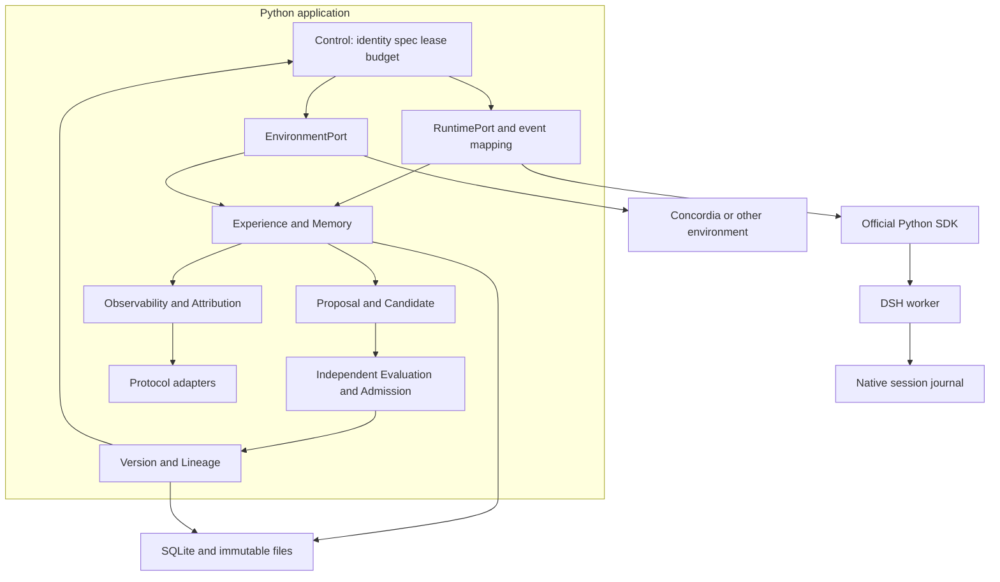
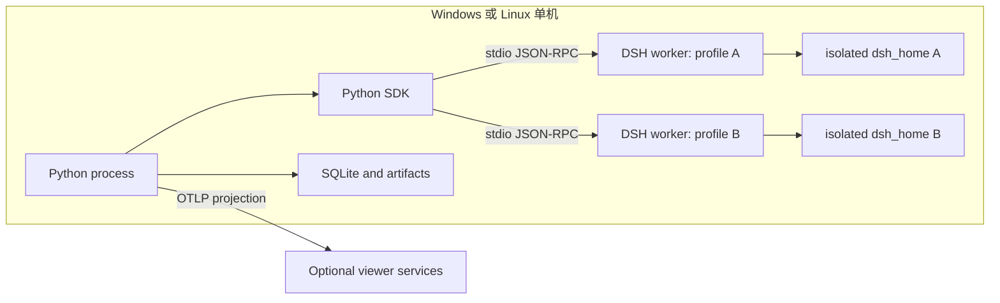
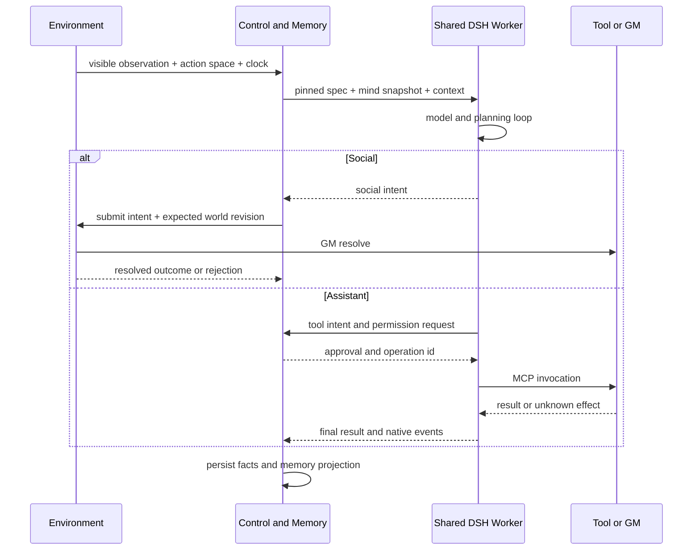
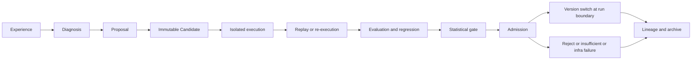

# 03 · 目标架构与部署边界

独立 Python Control Plane 保留 DSH 的 loop、plugin、session、model/tool/MCP 和 SDK；Actio 增加域抽象、事件与恢复协议。七个 Plane 是责任视图，首期一个 Python 应用+受管 worker 进程（ADR01–05）。

## Context

观察经可见性过滤后进入 runtime；写效果工具经权限/效果账本批准。GM 模型调用属于 Environment 成本，导出 provenance；agent 不能直接修改 world。

## 组件依赖

Python 不是 session 第二写者，只订阅/读取并保存 source cursor→canonical 映射。SQLite 存索引、revision、lease、decision、namespace、outbox；大 payload/manifest 放 hash 文件。Graphiti/Vector 不在最小部署中；关系检索确有收益再加投影。Viewer dataset/score 是副本，不可改回封存 evaluator。

## 同机部署

worker 按冻结 profile 隔离，不能由 E001 推出单 worker 可承载异构 roster。初期每活跃 session 独占或同配置顺序复用；清理/隔离验收后扩大复用。population 可多于活跃 worker；模型并发另设 token/request semaphore。

同机沿 SDK stdio，不自建 HTTP bridge。P2 多机才论证认证、artifact transfer、租约和断网恢复。WSL/Linux 用于 L2/container/Ray 和 viewer；Windows 先测 wheel、UTF-8、终止/子进程清理；没有本轮全栈可运行结论。

## 双场景数据流

control 的工具决策经域 plugin/RuntimePort 承接，实际协议与循环仍在 worker；Python 不再发一次操作。Assistant Environment 管工作区/工具效果状态；Social Environment 管世界。共用 run/episode/event/evaluator/version 字段，B07/B08 行为验收而非复用百分比。

## 演化与权限

Proposal 只读开发数据/授权诊断，只写候选区；Evaluation/Admission 用独立权限与冻结清单。原始事实、可变 memory、不可变版本谱系分开；viewer/proposer 失效不阻断事实落盘。
