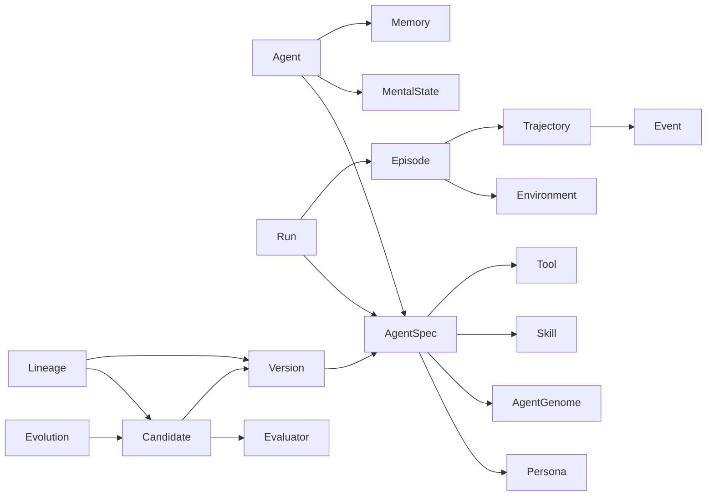

# 04 · 领域对象、版本与所有权

ID 使用不透明全局唯一值，内容版本使用 hash；Agent ID 稳定，AgentVersion ID 不可变。时间同时记录 wall/simulation time；可变指针必须 expected_revision/CAS。以下仅合同草案。

## 对象

| 对象 | ID / 引用 | 生命周期与不可变部分 | 唯一 owner |
|---|---|---|---|
| Agent | agent_id、population_id、active_version | registered→active→suspended→retired；身份不因 run 变化 | Python identity |
| AgentSpec | spec_id/hash；persona/model/runtime/plugin/tool/skill/memory_policy | sealed 后不可改，变更产生新 spec | Python registry |
| AgentGenome | base_spec、seat、allowlist、compatibility | AgentSpec 可演化字段受限视图，不是全部配置 | evolution validator |
| Persona | persona_id/version、来源/抽样/校准/许可 | 稳定身份修订须显式版本，不原位覆盖 | Python identity |
| MentalState | agent/branch/revision，belief/goal/intention/emotion | 事件驱动 CAS 的主观状态，不是世界真相 | Python mind |
| Memory | memory_id/version、M层、observer、source events、双时间 | revision/tombstone；consolidation 新记录保留源链 | Python memory |
| Skill | skill_id/version、instructions/artifact、能力/效果类别 | immutable release，allowlist 管控 | Python registry，worker 只加载 |
| Tool | tool_id/schema_hash/version、permission/effect_class | binding 变更版本化，execution 有 op_id/attempt | 工具拥有实际效果；control 拥有 ledger |
| Environment | env_id/version、capabilities、world_ref/clock | episode 实例拥有 world，snapshot 按能力 | simulator / assistant environment |
| Run | run_id、spec/pins/lease、budget/mode | created→running→draining→completed/failed/cancelled/needs_reconcile | Python control |
| Episode | episode_id、run、scenario/split、initial_state | open→pending/resolving→terminal；部分失败可 unknown | 环境管世界，Python 管关联记录 |
| Event | event_id、stream/source_seq、parents、hash | committed fact append-only；修订新增事实 | canonical writer |
| Trajectory | trajectory_id/hash、event refs/offsets | 完成后不可变，partial 显式标记 | Python experience |
| Evaluator | evaluator_id/version/hash、rubric/split/judge | 封存后不可改，修改开新 campaign | evaluator steward |
| Candidate | candidate_id/hash、parents、diff、seat | proposed→validated→evaluating→decided；保留无效/失败 | proposer 提案，control 封存 |
| Evolution | evolution_id、campaign/budget/candidates | 多轮必须 stop rule，历史不可篡改 | evolution coordinator |
| Version | version_id/hash、pins、decision_ref | admitted→active→superseded/revoked；active pointer 可换 | admission/version registry |
| Lineage | edge_id、parent/candidate/version/evidence | DAG append-only，重组多父均保留 | Python lineage |

## Owner / readers / update / conflict

| 状态 | writer/owner | readers | update protocol | 冲突与恢复 |
|---|---|---|---|---|
| identity/spec/version/lineage | Python registry/admission | worker、环境、评估 | immutable artifact + pointer CAS | stale revision 拒绝；active version 下个 run 生效 |
| native session journal | DSH persistence | SDK/ingestion、审计 | 上游 handle/lease/flush；Python 不写 | kernel lock 与 control fencing 不等价，旧进程必须退出或隔离 |
| canonical facts/cursor | Python event writer | memory、eval、exporter | 同事务 event+dedup key+cursor+outbox | 同源键不同 hash→corruption；缺 seq 补拉或 incomplete |
| MentalState | Python mind | context builder、受限评委 | revision + source facts | 候选只提 delta，冲突重推导，不 last-write-wins |
| Memory | Python memory | 检索、可选 Graphiti projector | namespace+revision+policy/model pins | branch copy-on-write；投影无权覆盖原记录 |
| Tool ledger | control effect policy；工具拥有效果 | worker、reconciler | approved→started→succeeded/failed/unknown | 回执丢失不盲重试非幂等写 |
| world/clock/scheduler | environment | bridge、实验者、可见 agent | intent+expected world revision→resolved fact | stale intent 拒绝；失败 tick 由环境 reconcile |
| candidate | proposer 候选区 | validators/evaluator | seal immutable；禁写规则/预算/隐藏数据 | 越界→invalid；事件仍留存 |
| evaluator/admission | 独立 steward/executor | coordinator、受限报告 | campaign hash + authorized decision | 改规则开新 campaign；proposer 无写权 |

## Crash 与版本边界

worker crash：标 lease suspect→停新指令→确认旧进程退出/隔离→提升 fencing epoch→读合法 native 前缀→补 canonical cursor→reconcile 工具 pending→对齐环境裁决与 memory revision。只有 hash 匹配且完整的 manifest 可 resume；否则 episode 起点重执行或 needs_reconcile。不能凭 TTL 抢仍存活的 DSH kernel lock（E003）。

可替换 worker 表示新进程可加载兼容 pin/状态，不代表 session、plugin 内存、工具句柄无状态。未知 transient 状态必须排空或标不可恢复。

Pin manifest：runtime package/commit/wheel hash、SDK、plugins/skills/tools schema/artifact、provider/model/endpoint/revision（可得时）、temperature/seed、spec/persona/memory policy、environment/scenario/clock policy、evaluator/rubric/dataset/split、domain/native schema、migration version。无法冻结模型权重时记 provider_revision_unknown，降低重执行证据强度。

同 major schema 允许可选字段新增；未知权限绝不默许。major 不兼容拒绝或显式离线迁移，记录输入/输出 hash 与迁移版本。Memory migration 先写新 namespace/revision并验证，保留旧快照。版本 rollback 只切未来 run；memory rollback 是独立旧快照/前向修复；world restore 受环境能力约束。进行中 run 保持原 pin，紧急撤销则终止并 reconcile 外部效果。
