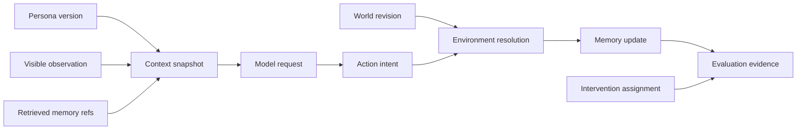

# 09 · 观测、回放与归因边界

Observability回答发生什么；Provenance回答引用了哪些来源/状态；Attribution需要干预、对照和识别假设。日志关联、LLM解释或DAG箭头本身不构成因果证明。

## 回放类型与当前源码能力

L=log replay；I=recorded-I/O replay；R=resume；X=re-execution；B=branch；C=counterfactual experiment。表中“部分”指可用片段，不代表端到端实现；本轮无目标集成通过。

| 项目 | L | I | R | X | B | C | 证据限制 |
|---|---|---|---|---|---|---|---|
| DSH | 原生日志实现 | 未证实通用录放 | 内部实现，SDK缺口 | 可再次调用，不确定 | session seq fork实现 | 无完整环境实验 | E001–E003 |
| Raven root/evolver | DAG manifest/eval历史 | 未证实 | JSON/工作区恢复部分 | benchmark执行存在 | Git candidate lineage | 需独立实验设计 | E007–E009 |
| Letta Code | transcript/git memory | 未证实工具录放 | local/store存在 | 非严格确定 | conversation/memory版本不等于世界分支 | 未证实 | E013/E014 |
| Strands | messages/snapshots | 未证实通用录放 | Python/TS各有不同实现 | 可重调，不确定 | snapshot恢复部分 | 未证实 | E015/E016 |
| Concordia | raw log | GM/model I/O未完整冻结 | component部分 | 从起点可重新运行 | external Entity/engine cursor缺口 | Actio设计，未实现 | E017/E018 |
| AgentSociety | trace/timeline | 未证实 | workspace恢复 | Ray/外部服务不确定 | 完整batch分支未证实 | 未实现 | E019 |
| OASIS | DB/platform trace | 未证实 | DB不含全部queue/RNG | 推荐/模型/调度影响 | 全平台快照未证实 | 未实现 | E020 |
| Graphiti | episode/fact来源 | 不适用执行录放 | DB服务持久 | 抽取模型有漂移 | group不是自动隔离 | 未实现 | E021 |
| Phoenix/Langfuse | trace可查看/导出 | 不等于工具录放 | 仅自身数据服务 | 不负责solver重执行 | 非世界分支 | 非因果平台 | E024/E025 |
| Meta/DGM | candidate/eval记录 | 不保证 | 研究resume片段 | benchmark执行 | candidate fork | 非社会counterfactual | E010/E011 |

定义：log replay只展示历史；I/O replay只在规范化请求hash、输入状态和工具版本匹配时返回录制结果；resume继续同一次未完成运行；re-execution从指定初始条件重新运行，结果允许不同；branch产生独立namespace和谱系；counterfactual是有预注册干预/对照的branch experiment。干预改变下游输入后，旧响应不可套用，必须重执行或标unsupported。

## Checkpoint manifest（文档级草案）

| 域 | 必需字段/覆盖声明 |
|---|---|
| identity/runtime | spec/persona/genome/agent_version refs；runtime/SDK/plugin/skill/tool schema+artifact hashes |
| mind/memory | mental_revision、memory_snapshot、namespace、policy/renderer/extractor/model versions |
| environment | env/scenario版本、world snapshot ref、clock、scheduler cursor、可见性状态、pending intents、excluded_state |
| tools | op ledger offset、effect class、receipts、recorded request/response refs、未确认操作列表 |
| models | provider/model/revision可得值、request模板、seed/temperature、response refs；未知revision显式记载 |
| randomness | Python/TS/env RNG状态、采样seed及覆盖；远端seed不保证确定 |
| events | source cursors、canonical offset、mapping/schema versions、last hash、missing sequences |
| durability | manifest hash、artifact hashes/sizes、capture epoch、lease fencing token、quiescence确认、complete/partial |

capture顺序：停止新dispatch→排空或冻结pending→各owner确认可捕获边界→写不可变artifacts→校验hash→原子提交manifest。任何owner不支持或pending无法冻结，manifest partial；不能宣传完整恢复。首期Concordia默认episode起点manifest，mid-run branch必须额外证明engine/GM/external Entity一致性。

工具分级：read-only可按请求匹配录放；idempotent-write必须同业务idempotency key并验证目标结果；non-idempotent-write不自动重发，unknown effect走reconcile。版本回滚与记忆回滚与世界恢复分别产生事件，无法逆转的真实效果写明。

## Canonical Provenance DAG 与 viewer

边带类型与证据，不统一命名causal。检测环/缺parent；跨流缺parent可保留unresolved边但禁止将不完整DAG作为归因结论。OTel span最多一个parent，其他来源映射links/attributes；canonical多父DAG独立保留。建议trace=episode或run、span=model/tool/resolution，事件ID和artifact ref放attributes，敏感payload不直接导出。

Langfuse社区viewer主选provisional：真实OTLP/dataset/score接口可投影，但多服务运维与EE许可例外需B13准入；Phoenix内部备选受ELv2托管限制。OTel SDK1.45.0有界queue可能drop，force_flush/timeout不等于域可靠投递；canonical outbox可重建viewer，viewer丢失不导致实验事实丢失。

## 第一干预实验

干预单元：整个双agent协商episode；变量：行动前检查清单是否启用；对照：v1；冻结Persona、初始belief/memory、scenario、action space、预算、模型标识、GM/evaluator版本。随机arm执行顺序，按scenario family成对，记录provider时段。

重复：独立场景实例按B09功效/预算确定，至少报告有效cluster N，不把轮次/消息当独立样本。指标：可行方案率、身份违背、可见性违规、社会rubric、calls/token/cost；CI按cluster/配对设计，候选搜索与最终holdout分离。ablation分别去掉记忆retrieval或检查清单，不同干预开独立branch。

混杂：GM随机裁决、provider漂移、agent间干扰、评委共享偏差、记忆污染、选择性失败。解决到何种程度须报告；无法控制外部工具/环境时只给描述性差异。MVP交付“在此冻结条件和场景分布下的受控差异证据”；推广到真实社会或个体因果效应需要额外可交换性、干扰结构与外部有效性假设。
