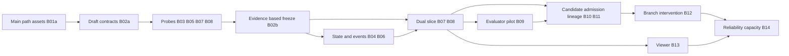

# 11 · 10 周主路线、8–12 周窗口

假设2名全职工程师（runtime/state、实验/环境各1）+0.5名研究/评估负责人，合计约25人周/10周；许可/运维审阅约0.1人月外援。下表主工作合计约19–25人周，另留3–5人周风险缓冲；10周目标只能容纳主工作约20–22人周与剩余缓冲，取上界时需要12周或缩范围。重叠任务不能重复计可用人员。单人实施预计显著超出12周，不用并行图伪造工期。

输入条件：目标依赖artifact可获取、模型/数据使用授权与预算、Linux或WSL验证环境、可冻结的首批scenario/evaluator、Concordia依赖可安装。本轮只规划，未花模型费用、未部署服务。

| 窗口 | 任务/工作量估算 | 并行与验收/退出 |
|---|---|---|
| W1–2 | B01a→B02a→B03/必要B05/B07/B08 probes→B02b，2–3人周；初探5工程日为预算估算 | 只准入主路径 artifacts，按实测冻结最小合同；G0 公开配置/窄plugin/最小补丁仍不可行才触发 Strands 同合同探针；下载阻塞不是技术退出 |
| W2–4 | B03–B06，5–6人周 | 一人runtime/生命周期，一人event/memory；UTF-8/子进程/lease/背压/恢复通过；无需viewer |
| W4–6 | B07/B08双slice，3–4人周；B09评估2人周可早并行 | 同一runtime、schema、memory/eval/version；环境非法动作不改world；无第二loop |
| W6–8 | B10/B11，3–4人周 | 单seat候选、独立评估、四态准入、完整lineage，所有候选拒绝也可通过流程验收 |
| W8–9 | B12，1.5–2人周；B13，1–1.5人周 | 起点branch/干预证据；partial snapshot如实拒绝；viewer延迟不阻断闭环 |
| W9–10 | B14，1.5–2.5人周 | crash/reconcile、100人口/受限并发容量、预算和恢复演示 |
| W11–12缓冲 | 3–5人周容量，不能全预订 | DSH补丁/平台依赖/评委校准；若超过则延期Graphiti、第二adapter、mid-run branch与viewer |

关键路径（2026-10-07 F05）：真实启动/隔离/最终授权/有界失败→canonical occurrence 一致性→双场景运行与失败恢复验收→B09 pilot→admission/lineage。B01a 不要求所有 A/B/C 许可闭包，B02a 不先冻结十个 API；B02b 以 [Phase 1A](../validation/phase1a/README.md) 证据冻结验证子集。full resume/fork/status/catchup 属于 G1，不能与 G0 启停和 unknown 识别同级阻断。5 工程日与 1–2 人周均为历史预算估算，不等待时间或自动触发换框架。

## 第一演化Demo

v1在小型协商与只读助手任务上运行→识别“未核对行动约束”失败→提出单seat行动前检查清单c1→静态allowlist校验→隔离namespace执行→baseline/candidate配对→回归→四态decision→若pass发布v2，否则保留v1。展示所有artifact：v1/spec、失败trajectory、proposal、candidate hash、evaluation/raw results、decision、lineage、active pointer。手动触发回滚仅影响新run；真实工具效果另行reconcile。

故障演示至少：非法mutation被拒绝；judge空结果成为infra_failure；有效样本不足成为insufficient；worker在工具回执前崩溃进入unknown；相同事件重复不双计；branch memory不污染baseline。不得降低gate来保证晋升。

## 容量与费用模型

变量：人口P、每episode实际参与A、episodes E、每agent turns T、每turn模型calls Q、候选C、独立repeats R、GMcalls G、judgecalls J、proposal/diagnosis calls H。任务调用 `A×E×T×Q`；若每candidate配对一份当期baseline，search约 `2×C×R×A×E×T×Q`，再加pilot/final holdout、GM、judge、proposal和重试。复用baseline可省钱但增加跨时段漂移，不能无记录混用。

示例仅为预算假设：P=10，A=10，E=20，T=6，Q=2→单arm 2,400 calls。C=3、R=2、每候选独立配对→28,800 solver calls；GM每episode每turn1次约1,440 calls；judge每episode2次约480 calls；proposal/diagnosis 60 calls。合计30,780；预留10%失败重试约33,858 calls；另留25% pilot/final约42,323 calls。validation独立N与power仍按B09，不用该示例声称足够显著。

假设平均输入2,000/output500 tokens，示例单价 $1/$4 每百万input/output tokens（**不是任何供应商报价**），每call约$0.004，总约$169；长上下文均价翻5倍即约$846。实际按每模型token×价格分项，另算cache、embedding、工具、存储、viewer和人工标注。run/campaign有hard cap，候选不能提高预算。

并发：先4活跃worker、最多8模型请求（需实测provider quota与worker并行语义）；人口100仍可分批调度。估算理想时长≥总calls×平均latency/有效并发，再加顺序依赖/GM/barrier；平均5s、有效并发8则42,323 calls约7.35小时只是理想下界。人口1K不等于1K node进程，需持久状态+受限池；本轮不承诺该规模吞吐。

存储示例：每call10条event、每条2KiB envelope及索引前数据→约0.81GiB；每call input/output artifact平均20KiB→约0.81GiB；考虑journal、SQLite index、版本、重复试验与备份按3–5倍预留5–10GiB。磁盘/事件速率需B14实测；payload不可无限inline。

## 平台与后续

Windows：优先Python/DSH x64 wheel与只读MCP，UTF-8、路径、进程退出实际验证。WSL/Linux：Concordia依赖、Ray/容器与L2隔离优先验证，不假设Windows源码存在就能全跑。Langfuse多服务先用可丢弃环境评估资源；Phoenix内部使用另审ELv2。首期无需K8s/GPU。

Phase2：AgentSociety真实adapter、Graphiti收益实验、多机worker、A2A/ACP facade、mid-run checkpoint、受控L2。研究：社会评价效度、干扰下因果识别、长期身份漂移、跨域收益。长期：1K容量、训练artifact接入与L3外部作业；不在本轮实现清单。
