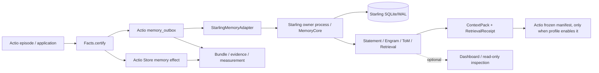

# Actio-RSI × Starling Memory 接入总计划

**状态：规划草案，基于两个仓库截至 2026-10-27 的本地源码与公开主分支快照。**

本文件回答四个问题：Starling 能为 Actio-RSI 提供什么、两者如何协作、接入应先做什么、还需要向 Starling 提出哪些能力要求。实现前必须先完成 Windows 构建可行性探针和最小离线闭环；本文件不代表已经接入或已经产生新的实验结果。

## 1. 结论先行

建议把 Starling 接成 **可选的、可审计的认知记忆投影**，而不是替换 Actio 现有的记忆表，也不是让 Starling 成为运行、账务或证据的第二权威。

具体分工如下：

| 权威问题 | Actio-RSI | Starling Memory |
|---|---|---|
| 一次 run 是否被授权、执行到哪里、是否完整 | 唯一权威：`Store`、`Ledger`、`Facts`、terminal/bundle | 只接收已经认证的来源，不能改变结论 |
| 原始运行事实与证据 | 唯一权威：native journal、occurrence、projection、bundle | 以 Engram 保存受控副本或摘要，并保留 Actio source key/hash |
| 现有 episodic memory 的 CAS、revision、跨环境授权 | 当前 `application.memory.Memory` 与 Actio SQLite | 作为兼容 fallback；Starling 投影失败不回滚它 |
| 社会心智、主体归属、二阶信念、语义检索 | 目前只保留 namespace/快照 | Starling 的 Statement、Cognizer、ToM、Retrieval Planner |
| 巩固、重放、遗忘、再巩固、前瞻承诺 | Actio 目前没有同等运行时 | Starling `tick`、Replay、Reconsolidation、Prospective Loop |
| 评估、候选谱系、准入 | 唯一权威：Actio evidence/measurement/lineage | 作为可控实验变量和诊断来源 |

第一阶段不把 Starling 的上下文直接注入生产 solver。先做离线 shadow projection 和同一输入的 A/B 只读比较；只有当来源锚定、租户隔离、回放冻结和失败降级都通过后，才允许把 Starling context pack 作为显式 profile 能力。

## 2. Actio-RSI 当前工程理解

### 2.1 定位和模块

Actio 是面向持久身份、社会交互与受控演化 Agent 的 Python 模块化单体。九个核心模块通过 ports 连接：

- `contracts` 规范化 wire、hash、端口数据和输入合同；
- `domain` 维护身份、namespace、episode、clock、账务和状态规则；
- `tasks` 负责任务 family、actor 可见性、action space 和版本选择；
- `profiles` 冻结运行模式、期限、准入、usage、pins；
- `application` 编排 claim → freeze → run → certify → persist → export；
- `adapters` 接入 SQLite/Ledger、DSH Worker、Concordia、transport 和文件系统；
- `evidence` 认证 native stream、协议、账务、bundle、campaign、lineage 和失败；
- `measurement` 使用独立 oracle 计算指标，不复用生产裁决；
- `interfaces` 装配 CLI、IPC、workers 和可信入口。

源码证据是 `src/actio/README.md`、`docs/architecture/MODULES.md`、`docs/architecture/FLOWS.md` 和 `docs/planning/README.md`。当前 README 明确记录：工程处于 0.2.0 入口迁移验收中，实验停在 C5，不能把工程验收说成研究有效性或激活资格。

### 2.2 当前 memory 语义

Actio 当前的 memory 不是通用向量记忆，而是受约束的 episodic effect：

1. `domain.memory.namespace()` 只允许 `project=synthetic`、`branch=main`、`visibility=private`，环境为 `assistant` 或 `social`。
2. `application.memory.Memory.authorize()` 强制 agent 与 namespace 一致，并按 agent spec 的 `memory_shares` 控制跨环境读取。
3. `Memory.write()` 只接受经 `Facts` 认证的 `(stream, seq, slot)`，slot 必须是 pinned consumer 允许的 `assistant.final`；来源 run 必须完整、非 replay、环境一致，且存在 pinned projection。
4. 写入在 Actio Store 的同一事务里完成 revision CAS、effect 去重、audit 和 correction；内容限制为 UTF-8 16 KiB。
5. `Memory.retrieve()` 按 revision 生成稳定快照，限制条数和 16 KiB context，并写入 retrieval receipt/hash。
6. `application.scenarios` 在 assistant/social run 开始时冻结 memory snapshot；`concordia.py` 在每个 actor 行动时使用冻结快照，不读取运行中变化的记忆。
7. `export.py` 和 `evidence.bundles.verify` 校验 memory effect 必须对应最后一条 `assistant/message`，并且 terminal/bundle 可重算。

因此，Starling 不能在 episode 中隐式修改 Actio memory，也不能让一次 recall 结果改变已经冻结的 replay 输入。

### 2.3 当前运行与持久化边界

`EpisodePorts` 从 `interfaces/wiring.py` 注入 `RuntimePort`、`TransportPort`、Concordia、`Facts`、`Ledger` 等能力。Runtime 的 native journal 由 `Facts.collect/certify` 认证；Store 与 Ledger 分别拥有自己的连接和事务，没有跨库原子提交承诺。外部效果必须有 scope、deadline、cleanup、raw receipt 和错误状态。

这正是 Starling 接入的主要约束：Starling 另有自己的 SQLite/WAL 和 C++ 写门，不能通过共享连接或跨数据库事务制造“伪原子”。

## 3. Starling Memory 当前能力理解

### 3.1 产品定位

Starling 是 C++20 + raw SQLite 的多主体社会心智和类脑记忆运行时，Python 通过 pybind11 绑定。其 README 明确把系统定义为数据模型、运行时调度器和检索规划器三件套，可以挂在其他 memory stack 之上，而非简单的 `user_id + vector-RAG`。

其核心公理和能力是：

1. 每条记忆是带 holder、subject、predicate、object、modality、polarity、time、evidence、confidence 的 `Statement`，不是无归属的 fact。
2. `Cognizer` 是一等主体，支持人物、agent、group、role、external 等类型、别名和关系。
3. Statement 支持嵌套和 `nesting_depth`，可表达“我相信你相信……”。
4. 记忆生命周期有 `VOLATILE`、重放/再巩固、`CONSOLIDATED`、`ARCHIVED`、`FORGOTTEN` 六态。
5. Reconsolidation 通过 supersedes 链保留旧版本，不覆盖历史。
6. Prospective Loop 提供 typed Trigger 和 Commitment 状态机，可在无新用户查询时产生待办提醒。
7. Retrieval Planner 按 `(querier, perspective, intent, goal)` 规划检索，返回 Context Pack、receipt 和显式 abstention。

### 3.2 实际 Python 入口和限制

当前 public facade 位于 `starling/python/starling/memory.py`，核心编排位于 `_memory_core.py`：

```python
mem = starling.Memory.open(
    db_path,
    agent="alice",
    tenant_id="actio-tenant",
    llm=starling.make_stub_llm(default_response=JSON_ARRAY),
)
mem.remember(text, holder="alice", interlocutor="bob", now=now)
mem.recall(query, perspective="first_person", k=10, mode="semantic")
mem.query(text, intent="FACT_LOOKUP", perspective="first_person", k=10, now=now)
mem.tick(now)
mem.render_working_set(interlocutor="bob", goal="auth", token_budget=2000)
mem.close()
```

当前实现需要在接入设计中明确处理以下限制：

- `Memory.open()` 的 facade 固定安装 `StubEmbeddingAdapter(8)`；不能把默认 semantic recall 当成生产质量，真实 embedding 需要新增配置/adapter 能力并单独评测。
- `remember()` 没有 LLM 会 fail fast；模型抽取失败通过 `RememberResult.extraction_failed/outcome` 暴露，不能把“零 statement”误判成成功。
- `tick()` 会推进 embedding、commitment、replay/投影等后台阶段；必须从 Actio Clock 传入确定的 `now`，不能依赖 facade 的演示默认时间。
- 单一 adapter/WAL 写入纪律在 quickstart 和测试中被明确强调；不能在同一个 DB 上并发打开多个不受协调的 SqliteAdapter。
- Runtime 有 C++ preflight 和 `READY/DEGRADED/UNREADY` 健康门；UNREADY 时写门 fail-closed，不能由 Actio 自动绕过。
- 仓库的 CMake presets 只有通用、Linux、macOS 路径；当前 Windows 工作区没有 cmake/ninja 命令，且文档只明确 Linux/macOS。Windows 构建/ABI 是接入前的硬门槛。

### 3.3 可复用的公开能力

| Starling 能力 | 对 Actio 的直接价值 | 接入阶段 |
|---|---|---|
| Engram + source hash/span/time | 把 assistant.final、tool observation、episode 结果保留为可回链证据 | P1 |
| Cognizer/alias/social graph | 把 A/B、用户、agent、环境角色从普通字符串升级为稳定主体 | P2 |
| Statement modality/polarity/confidence | 区分观察、相信、知道、怀疑、承诺、偏好、规范 | P2 |
| Perspective/ToM | 社交 episode 中分开“行动者认为”和“Actio 观察到” | P3 |
| Query intent/abstention/receipt | 为 solver prompt 提供可解释、可审计的 memory context | P3 |
| Working Set | 将 persona、common ground、relevant memories、commitments、affect 合成有预算的输入 | P3 |
| tick/replay/reconsolidation | 让历史交互积累稳定语义，形成可实验的记忆动力学 | P4 |
| commitments/triggers | 把承诺转成未来 Actio task 候选，而不是直接执行外部动作 | P5 |
| dashboard/inspection | 调试 memory state、receipt、lifecycle 和 provenance | P1/P4，可选 |

## 4. 目标架构



关键原则：

1. Actio source `(stream, seq, slot, mapper)` 和 `raw_hash` 是跨系统关联键；Starling 的 `engram_ref`、statement ids 和 receipt 是派生回执。
2. `memory_outbox` 在 Actio Store 事务内落盘，Starling 投影在事务外执行；投影状态用 saga/outbox 表达，不声称跨 DB 原子提交。
3. Starling 只接收已通过 Facts 的内容；未经认证的 native journal、provider stderr、credential、GM private log 和未批准 prompt 不进入 memory。
4. 默认使用 shadow/read-only 结果；要把 context pack 送给 solver，必须把 pack、receipt、hash、Starling capability/pin 和时间一起冻结进 run manifest。
5. replay 使用原 manifest 中的冻结 context，不重新向 Starling 查询；历史 replay 不被当前 Starling DB 的变化污染。
6. Starling 不调用 Actio `Ledger`，不决定预算，不确认 domain effect，不推进 candidate/evaluation decision。

## 5. 分阶段实施计划

### P0：构建、ABI 与边界探针（先决条件）

目标是证明“能安全运行”，不是证明 memory 质量。

- 固定 Starling 源码 commit、license、C++/SQLite/OpenSSL/ICU/pybind11 依赖和 Python 3.12 ABI；记录 source hash。
- 在当前 Windows 主机尝试官方 `scripts/configure_build.py` 或等价 CMake 配置；若无法稳定生成 Python extension，先建立 Linux owner-process/sidecar 路径，不能把未编译的 Starling 伪装成 Actio 依赖。
- 跑 Starling offline quickstart、`test_memory_facade.py`、preflight、tenant/holder/retrieval receipt 相关测试；确认 DB、WAL、单写者和关闭顺序。
- 验证 Actio 的 `--no-deps`/纯离线测试在没有 Starling 时完全不受影响。

**Gate P0：** 可重复启动、`remember → query → tick → working_set → close` 全链路通过；UNREADY/LLM 缺失/抽取失败/DB 锁定均有可观测错误；Windows 或 sidecar 运行模式有明确结论。

### P1：认证来源的 shadow projection

不改变 solver 输入、不改变 Actio success/failure。

- 新增 `StarlingMemoryAdapter`，只消费 `Facts.certify` 返回的 assistant.final 和显式允许的 tool/world observation。
- 新增 Actio `memory_outbox`/`memory_projection` 记录 source key、source hash、namespace、payload policy、状态、attempt、Starling receipt 和错误。
- 投影 payload 只包含最小文本和元数据：`tenant_id`、`holder/agent`、`interlocutor`、`run_id`、`stream/seq/slot`、`observed_at`、`raw_hash`、privacy class；凭据和内部 transport 原文默认禁止。
- 以 source key 做幂等：重复 outbox 不重复追加 Engram；纠正必须成为新的 source/version，不能覆盖旧 statement。
- 维护命令输出 projection lag、失败原因、Starling health 和 receipt hash；不在 episode finally 中无限重试。

**Gate P1：** 认证 source 与 Starling Engram 一一可回链；重复 run/replay 不造成重复 memory；Starling 不可用时 Actio episode、bundle、ledger 和现有 memory 仍通过。

### P2：语义模型与多主体映射

- 定义稳定映射：Actio agent → Starling self Cognizer；A/B/user/tool/environment → typed Cognizer/Entity；Actio namespace 的 project/branch/visibility → tenant/scope policy。
- 明确 `assistant`、`social` 的共享规则：优先使用独立 tenant 或 typed visibility join，禁止仅靠字符串拼接模拟 ACL。
- 将 `assistant.final` 写成 `SourceKind.OBSERVER_AGENT` 或受控 `USER_INPUT`/`TOOL_OBSERVATION`，把 Actio source hash 放入 Engram metadata/adapter provenance。
- 为 Starling Statement 规定 modality/polarity/provenance 默认值：运行事实用 `OCCURRED`，模型自述/推断不能直接升级成 `KNOWS`；`TOM_INFERRED` 和 `RECONSOLIDATION_DERIVED` 必须保留来源链。
- 将 Starling `review_status`、`confidence`、`consolidation_state` 映射到 Actio evidence 报告字段，不能把它们当作 Actio measurement score。

**Gate P2：** 跨 agent/environment 的正反向隔离测试通过；每条 statement 可解释 holder/perspective/source；误归属、跨 tenant 和 replay-derived 写入被拒绝或显式标注。

### P3：显式 context integration

- 新增 `memory_mode=off|shadow|frozen_context|live_context`，默认 `off` 或 `shadow`。
- 在 run freeze 阶段调用 Starling `query()`/`render_working_set()`，只将成功且未 abstain 的 context pack 写入 manifest；保存 `context_hash`、`receipt`、`as_of`、Starling version/capabilities 和 payload policy。
- `frozen_context` 的 prompt 只消费 manifest snapshot；`live_context` 仅用于实验 profile，必须在每次 recall 写入 receipt，并不允许 replay 使用。
- 将 Starling retrieval receipt 加入 bundle 的派生 evidence，独立报告 `abstained`、候选数、scope、预算截断和 source coverage。
- 为 token/byte budget 建立双重上限：Starling ContextBlock 自身预算 + Actio task/transport prompt 预算，超限按显式截断状态处理。

**Gate P3：** 同一冻结 manifest 在 Starling 数据变化、进程重启和 replay 时输出一致；memory unavailable/abstention 只导致明确的降级分支，不改变已认证事实。

### P4：后台动力学与实验

- 把 `tick(now)` 做成显式 maintenance command/worker，复用 Actio Clock、run id、operator scope 和 bounded deadline。
- 记录 `TickStats`、stage timings、stages skipped、health、replay batch id 和 Starling DB hash；失败进入 diagnostics，不修改旧 run 结论。
- 以固定 corpus 做 recall/abstention/contradiction/latency/byte-cost/privacy/forgetting/reconsolidation 对照；与 Actio measurement 分开，不把 Starling 内部分数当任务成功率。
- 先验证 semantic embedding 配置，再决定是否打开 source lane；默认 stub embedding 只能作为确定性测试实现。

### P5：ToM、commitment 和演化协作

- ToM 只作为社会任务的可选研究变量，必须区分观察、模型信念、共同基础和错误信念。
- Starling Commitment 只生成 Actio candidate/task proposal，经过现有 candidate/evaluation/approval gate 后才能执行；ActionGuard 不能绕开 Actio domain/evidence。
- 将 reconsolidation supersedes 链映射到 candidate/evaluation lineage 的外部引用，保持两套 lineage 各自权威。
- 只有在 P4 质量和成本门槛通过后，才考虑把 Starling 作为默认 memory provider；否则保持 shadow/实验 profile。

## 6. 主要风险、未决问题与期望

### 6.1 必须先解决的风险

1. **Windows 构建和 ABI：** 当前 Starling 文档/预设只明确 Linux/macOS；需要 MSVC/clang-cl、SQLite 3.46+、OpenSSL、ICU、pybind11、Ninja 的可复制构建说明，或官方 sidecar 发行物。
2. **双写一致性：** Starling 和 Actio 不可能共享一个事务；必须以 outbox、幂等、receipt、reconcile 和 degraded 状态表达事实。
3. **LLM 抽取成本与证据边界：** `remember()` 需要 LLM；默认不能在每个 episode 隐式触发外部请求。应支持 deterministic extractor、批量 ingest 和明确的 usage/cost receipt。
4. **Embedding 质量：** facade 固定 stub embedding；没有可配置 embedding/model pin 就不能宣称语义检索有效。
5. **多租户写者：** 需要 owner process 或可证明的串行队列；不能让每个 Actio episode 创建一个 Starling DB writer。
6. **回放确定性：** 当前 Starling 是会演化的动态数据库；Actio replay 必须冻结 context/receipt，不能重新 recall 当前状态。
7. **隐私/删除：** Starling 的 `forget/clear_tenant/crypto_erasure` 需要和 Actio bundle、immutable files、audit retention 的删除/保留规则对齐；“忘记”不能只删向量。

### 6.2 对 Starling 的具体期望

- 发布稳定、版本化的 Python/IPC adapter contract，而不是让 Actio 依赖 dashboard 内部 route 或 `_core` 私有 binding。
- 提供官方 `ingest` API：允许传入已抽取的 Statement/Engram、外部 source id/hash、observed/event time、privacy/retention，而不强制每次重新调用 LLM。
- 为 extraction、embedding、consolidation 分别配置 adapter、model pin、timeout/retry、usage receipt 和 offline stub；默认 fail-closed，不隐式重试。
- 支持一个进程内多个 tenant/holder 的串行 owner service，暴露 `health/capabilities/preflight` 和 graceful drain；明确 SQLite writer/concurrency contract。
- 所有 recall/working-set 返回 machine-readable receipt：query id、as-of、scope、candidate/excluded、abstention、budget、source hash 和版本。
- 提供时间可控的 `tick(now)`、replay batch id、状态迁移事件和 deterministic test clock；避免固定演示时间成为公共 API 默认值。
- 给出 Windows 构建/发布路径，或提供 Linux sidecar 的协议、安装包、签名、license 和升级/回滚策略。
- 明确删除、租户清空、加密擦除和审计保留的可验证语义；提供导出/导入和 source lineage，不让数据库成为不可迁移黑盒。
- 维护一套小型 offline conformance corpus，至少覆盖 holder/perspective、ToM、contradiction、abstention、supersedes、forget 和 cross-tenant 反例。

## 7. 完成定义（Definition of Done）

接入计划只有在以下条件全部满足后才可称为完成：

- Starling 源码、license、build/runtime pins 和平台路径可复现；
- Actio 无 Starling 运行的旧测试全部通过；
- P1 source key/hash/receipt 可从 Actio bundle 追到 Starling Engram/Statement；
- 投影重复、顺序、失败、重启、回收和 DB 锁定都有确定结果；
- Actio run/ledger/evidence/replay 的权威边界未改变；
- context pack 只有在显式 profile 开启且被冻结后才进入 solver；
- Starling 的 health、abstention、tick、forget、reconsolidation 和 cost/latency 都有独立指标；
- 至少一轮固定离线 corpus A/B 通过预注册门槛，且不把检索命中数冒充任务质量提升；
- 所有新增 CLI、schema、receipt、错误码和迁移都有 Markdown contract、测试和 rollback 说明。

## 8. 证据索引

### Actio-RSI

- `README.md`
- `docs/architecture/MODULES.md`
- `docs/architecture/FLOWS.md`
- `src/actio/domain/memory.py`
- `src/actio/application/memory.py`
- `src/actio/application/scenarios.py`
- `src/actio/adapters/runtime/facts.py`
- `src/actio/adapters/persistence/schema.sql`
- `src/actio/contracts/ports.py`
- `src/actio/interfaces/wiring.py`
- `tests/test_contract.py`、`tests/test_runtime.py`、`tests/test_reliability.py`

### Starling Memory

- `README.md`、`README.zh-CN.md`
- `pyproject.toml`
- `python/starling/memory.py`
- `python/starling/_memory_core.py`
- `python/starling/runtime.py`
- `python/starling/working_set.py`
- `python/starling/schema/statement.py`、`engram.py`、`cognizer.py`、`enums.py`
- `docs/design/system_design.md`
- `docs/design/subsystems_design/05_bus.md`、`06_engramstore.md`、`09_tom.md`、`13_retrieval.md`
- `examples/quickstart.py`、`tests/python/test_memory_facade.py`、`tests/python/test_retrieval_planner_e2e.py`
- 公开快照树：`be5ccf8de4bac10c448a11d0453af4fddac9ac7a`（主分支 tree SHA，下载于 2026-10-27）\n